# Design

The colors of the suite, where they are defined and what they are for. Text colors show a sample sentence in that
color; background colors (surfaces, fills, borders and lines) show a block. The samples are SVG files in
`bc250-bazzite/docs/design/colors/`. A text sample sits on a dark or a light backdrop, whichever its color reads on; a color with
an opacity (written `#rrggbbaa` here, `#aarrggbb` in the Qt code) shows over a checkerboard. The icons are in
[ICONS.md](ICONS.md). Written by `tools/make_design.py`: change the listing there and run it.

The rules say what makes each design recognizable; the color families say, for every tint of a hue, why it is
there; the listings after them say where every color is used.

## The rules

A design is recognizable by a few colors used the same way everywhere, not by a palette of every color there is.
Each design (a suite's, the Nexus page's) has its own; none is carried over to another.

### BC250 Bazzite Suite

- **The identity:** the purple of the board icon and the wiki (`#5835ce` with `#8a2be2`, the logo's `#6a1b9a`),
  and the apps' Gunmetal theme, steel gray with the steel-blue accent `#7e97ad`. Inter, with heavy titles. Every
  app has the icon of its category.
- **One theme for every app** (Gunmetal, Silver or Warm, the user's choice), from `core/bc250_core/theme.py`: the
  surfaces, text and accent below. An app adds no surface or text color of its own.
- **One state family,** the same in every theme: green `#2e7d32` ok, orange `#ef6c00` warn, red `#c62828` bad,
  blue `#1565c0` info, yellow `#fdd835` running, gray `#3a3f4b` neutral. A state is an edge or a dot on the theme's
  surface; a header box or pill in the neutral state shows the blue as its edge, as the portal's pills (owner,
  26-10-2026), never the theme's dark edge color. A red button is the red with `#b71c1c` pressed. Active red `#8b0000` (`#a00000` under the pointer) is a
  toggled-on state, never an error.
- **Text in a state color sits on a dark surface** in the next lighter tint of the same hue (Material's 300:
  red `#e57373`, orange `#ffb74d`, green `#81c784`, blue `#64b5f6`, purple `#ce93d8`), because the state fills read
  poorly as text on the dark views. The log in the check app uses them; a second tint of a hue is a deviation.
- **Brand and hardware colors stay what they are:** PlayStation blue and the face-button colors in the PlayStation
  apps, the light bar's and the color wheel's pure colors in HD Control, a game's own artwork, the gaming blue
  `#0a55b0` of the gaming category's icon in the emulator managers.
- **Anything else is a deviation**, listed under Color families below with the app it is in. A new color is
  added to the family it belongs to, or it needs a reason here.

### Nexus

- **The identity:** near-black ink `#010101`, silver text `#c0c0c0` and one teal `#17b6a7` (the icon's) for every
  link, title and icon; nothing else. Inter, with heavy titles. Nexus is not a suite: the page has no apps and no
  states. Its one app, Nexus Releases (`dev/releases/`, owner, 26-10-2026: a Nexus app takes Nexus's design), has
  this design in its window (`nexus_releases/style.py`, a theme for core's widgets: ink surfaces, silver text, the
  teal accent) and the Nexus icon; its states (the working tree, a build) are the apps' state family, since a build
  passes or fails there too.

## Color families

Every tint of each hue in the BC250 Bazzite Suite, and why it is there. *The family* is the suite's state color, *text tint* its lighter tint for text on a dark surface, *brand or icon* a color that belongs to something else (PlayStation, a tool ported, an icon), *hardware* a color the device shows, and *deviation* a second color for a job the family already has one for: there is none (the last were unified 26-10-2026).

### Red

| Color | Hex | Kind | Where and why |
| --- | --- | --- | --- |
|  | `#c62828` | the family | Bad: failed, an error, a problem; the red buttons. |
|  | `#b71c1c` | the family | A red button pressed or under the pointer (the bisect apps, Clean up logs). |
|  | `#8b0000` | the family | Active red: the GPU Governor's active button (a toggled-on state, not an error). |
|  | `#a00000` | the family | Active red under the pointer. |
|  | `#e57373` | text tint | Red text on a dark surface: the check app's findings, log, in-game checks, history and scores; the error labels of ACPI, CU Unlock and Cores Unlock; SFTP Tools' password requirements not met; NetcatGUI's error lines. |
|  | `#d04545` | brand or icon | NetcatGUI's red tab (its own palette, below). |
| 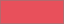 | `#e8505b` | brand or icon | PlayStation's circle: HD Control's circle button, DatStation's circle symbol. |
|  | `#ff2020` | hardware | The light bar's red; `#ff0000` the color wheel's. |

### Orange and yellow

| Color | Hex | Kind | Where and why |
| --- | --- | --- | --- |
|  | `#ef6c00` | the family | Warn. |
|  | `#fdd835` | the family | Running. |
| 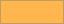 | `#ffb74d` | text tint | Orange text on a dark surface: the check app's warnings, log, in-game checks and middle scores; SFTP Tools' password warning. |
| 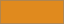 | `#e08a1e` | brand or icon | NetcatGUI's orange tab (its own palette, below). |
| 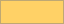 | `#ffd166` | brand or icon | DatStation's PS News symbol. |
| 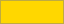 | `#ffd700` | brand or icon | DatStation's gold: trophies and stars; `#c0c0c0` silver, `#cd7f32` bronze. |
|  | `#ffff00` | hardware | The color wheel's yellow. |

### Green

| Color | Hex | Kind | Where and why |
| --- | --- | --- | --- |
|  | `#2e7d32` | the family | Ok: passed, valid, unlocked, a pressed controller button; a right answer. |
| 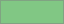 | `#81c784` | text tint | Green text on a dark surface: the check app's log success, in-game ok, a better result in its history and full scores; SFTP Tools' password requirements met; NetcatGUI's success lines. |
| 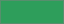 | `#2e9e5b` | brand or icon | NetcatGUI's green tab (its own palette, below). |
| 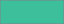 | `#3dbf9c` | brand or icon | PlayStation's triangle: HD Control's triangle button, DatStation's triangle symbol. |
| 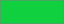 | `#10d040` | hardware | The light bar's green; `#00ff00` the color wheel's. |

### Blue

| Color | Hex | Kind | Where and why |
| --- | --- | --- | --- |
|  | `#1565c0` | the family | Info; the check app's GPU score box; HDMI CEC's adapter box. |
|  | `#64b5f6` | text tint | Blue text on a dark surface: the check app's info and hint findings. |
|  | `#0a55b0` | brand or icon | Gaming blue, the gaming icon's: the emulator managers' primary button, with `#2a6cc4` under the pointer and `#08448d` pressed; `#5b93da` their links. |
|  | `#003791` | brand or icon | PlayStation blue (DatStation), `#0072ce` light, `#1a85e0` under the pointer, `#00589f` pressed; `#4da3ef` its links. |
|  | `#6f9fe8` | brand or icon | PlayStation's cross: HD Control's cross button, DatStation's cross symbol (the square is `#e48fc0` in both). |
|  | `#3c7dd9` | brand or icon | NetcatGUI's header names and blue tab (its own palette, below). |
|  | `#1f3e9c` | brand or icon | BIOS Reader's bar and selection, with `#0b2a8a` and `#10205a`: a classic BIOS screen. |
| 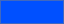 | `#0050ff` | hardware | The light bar's blue (the default); `#0000ff` the color wheel's. |

### Purple

| Color | Hex | Kind | Where and why |
| --- | --- | --- | --- |
|  | `#6a1b9a` | the family | The logo's purple, the suite's own state color. |
|  | `#5835ce` | the family | The wiki's purple, with `#8a2be2`: the suite's identity on the web. |
| 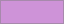 | `#ce93d8` | text tint | Purple text on a dark surface: the check app's log hints, Show in log link, in-game accent and the overlay's frame rate and border. |
|  | `#8b4fd8` | the family | The stage pill under the claim on the wiki's home page. |
|  | `#8e5bd0` | brand or icon | NetcatGUI's purple tab (its own palette, below). |
|  | `#a020f0` | hardware | The light bar's purple; `#ff00ff` the color wheel's magenta. |

### Palettes of their own

| Color | Hex | Kind | Where and why |
| --- | --- | --- | --- |
|  | `#d04545` | brand or icon | NetcatGUI's tabs: red, orange `#e08a1e`, green `#2e9e5b`, blue `#3c7dd9`, purple `#8e5bd0`, gray `#8a8f98`: the tab colors of the tool it ports, a user's choice per tab. |
|  | `#8a5a2e` | brand or icon | Upscaler's copper and teal `#0e6f75` boxes, cyan `#26a9b0` outlines: the icon's colors. |
|  | `#ad1457` | brand or icon | The check app's System overview: cores, threads `#00796b`, upload `#3949ab`, NVMe `#6d4c41`, packages `#5e35b1`, BIOS `#00838f`, a seventh series `#5d4037`: a chart's series, each told apart from the others. |

## The apps

The theme, the state colors and the style sheets are in `core/bc250_core/theme.py` (bundled per app; the apps that
are not on core yet carry a copy). The theme is one choice for every app: Gunmetal, Silver or Warm.

### Gunmetal (dark, the default)

Text colors:

- `#d9dde2` Text on every surface.

  

- `#82868b` Muted text: versions, hints, placeholders, disabled buttons (text and window mixed).

  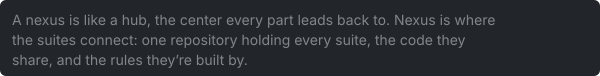

- `#ffffff` Text on the accent (selected rows and items).

  

- `#7e97ad` Links.

  

Background colors:

| Color | Hex | Used for |
| --- | --- | --- |
|  | `#2b2f34` | Window and dialog background; the selected tab. |
|  | `#22262a` | Text fields, lists, tables, tooltips, progress bars and scroll bars. |
|  | `#292d32` | Every other row of a list or table. |
|  | `#4a5058` | Button face, top of its sheen; scroll bar handles. |
|  | `#3b4048` | Button face, bottom of its sheen. |
|  | `#606872` | Palette light (the button face 30 % lighter). |
|  | `#14171a` | Borders and shadows. |
|  | `#7e97ad` | Accent: selection, focus, hover outline, progress, the selected tab's top edge. |

### Silver (light)

Text colors:

- `#1e2226` Text on every surface.

  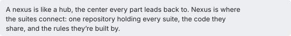

- `#7a7d81` Muted text: versions, hints, placeholders, disabled buttons.

  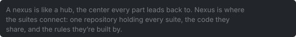

- `#ffffff` Text on the accent.

  

- `#5f7f9c` Links.

  

Background colors:

| Color | Hex | Used for |
| --- | --- | --- |
|  | `#d5d8dc` | Window and dialog background; the selected tab. |
|  | `#eceef0` | Text fields, lists, tables, tooltips, progress bars and scroll bars. |
|  | `#e2e5e8` | Every other row of a list or table. |
|  | `#eef0f2` | Button face, top of its sheen; scroll bar handles. |
|  | `#c4c8cd` | Button face, bottom of its sheen. |
|  | `#ffffff` | Palette light (the button face 30 % lighter). |
|  | `#8d9298` | Borders and shadows. |
|  | `#5f7f9c` | Accent: selection, focus, hover outline, progress, the selected tab's top edge. |

### Warm (dark)

Text colors:

- `#e3dfd8` Text on every surface.

  

- `#8c8984` Muted text: versions, hints, placeholders, disabled buttons.

  

- `#1b1a18` Text on the accent.

  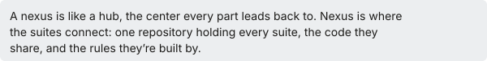

- `#b59a6e` Links.

  

Background colors:

| Color | Hex | Used for |
| --- | --- | --- |
| 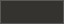 | `#35332f` | Window and dialog background; the selected tab. |
|  | `#292826` | Text fields, lists, tables, tooltips, progress bars and scroll bars. |
|  | `#302e2b` | Every other row of a list or table. |
|  | `#57534d` | Button face, top of its sheen; scroll bar handles. |
|  | `#45423d` | Button face, bottom of its sheen. |
|  | `#716c64` | Palette light (the button face 30 % lighter). |
| 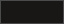 | `#181716` | Borders and shadows. |
| 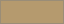 | `#b59a6e` | Accent: selection, focus, hover outline, progress, the selected tab's top edge. |

### State colors

The same in every theme: a state shows as a colored edge or dot on the theme's surfaces.

Text colors:

- `#2e7d32` Green: Passed, a valid entry.

  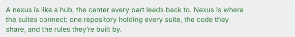

- `#c62828` Red: Failed, errors and problems in every app (the emulator managers' status lines, Nexus Releases' bad tags, the upscaler's problems, a folder that is missing).

  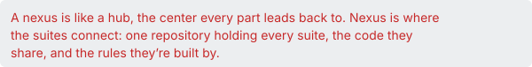

- `#ffffff` Bright text (palette BrightText); text on the state colors.

  

Background colors:

| Color | Hex | Used for |
| --- | --- | --- |
|  | `#2e7d32` | Green, ok: a state's edge or dot; an unlocked CU; a pressed controller button. |
|  | `#ef6c00` | Orange, warn. |
|  | `#c62828` | Red, bad; the red buttons of the bisect apps and of Clean up logs. |
|  | `#b71c1c` | The red buttons under the pointer or pressed (the bisect apps, Clean up logs). |
|  | `#1565c0` | Blue, info. |
|  | `#3a3f4b` | Gray, neutral. |
|  | `#6a1b9a` | Purple, the logo's purple. |
|  | `#fdd835` | Yellow, running: never confused with a failed (red) state. |
|  | `#8b0000` | Active red: the GPU Governor's active button. |
|  | `#a00000` | Active red on hover. |
| 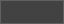 | `#424242` | Off: a locked CU, a core without a state. |
|  | `#1d4f91` | Steam artwork: the accent when an icon gives no bright color. |

## The wiki

`bc250-bazzite/docs/stylesheets/suite.css`, Material's slate scheme with the suite's purple.

### Wiki

Text colors:

- `#ffffff` Header, hero, cards and footer text; table headings; the stage pill; buttons on the dark and accent sections.

  

- `#ffffffb3` Dimmed text on the main and the hover color: the search field's hint.

  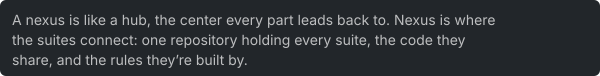

- `#a98bff` Suite soft: links in the dark scheme; hover on the dark section; footer column headings.

  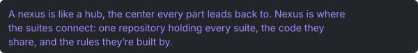

- `#c9bfee` Suite mist: card text and footer links.

  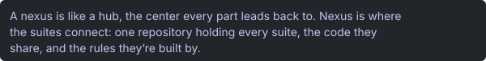

- `#1e1340` Suite deep: a button's text on hover in the dark and accent sections.

  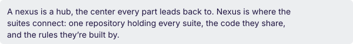

Background colors:

| Color | Hex | Used for |
| --- | --- | --- |
|  | `#5835ce` | Suite primary: Material's primary color, table headings, page icons, the hero and Get started gradients. |
|  | `#7a5ce0` | Primary, light. |
|  | `#4426a8` | Primary, dark. |
|  | `#8a2be2` | Suite secondary: the accent (hover rings on linked images), the end of the gradients. |
|  | `#8a2be21a` | The accent at 10 %. |
| 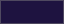 | `#1e1340` | Suite deep: header and tabs, the hero's top, the Download button. |
|  | `#120c22` | Suite ink: the dark section and the home page's footer. |
| 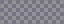 | `#120c2273` | The shadow under the board and the controller at the top of the home page (45 %). |
|  | `#17141f` | Page background (the dark scheme). |
|  | `#8b4fd8` | The stage pill under the claim. |
|  | `#ffffff` | Button background on hover in the dark and accent sections. |
|  | `#ffffff1f` | Behind a link in the header under the pointer (12 %). |
|  | `#00000040` | The shadow under a button under the pointer (25 %). |
|  | `#00000059` | The strip with the notice at the bottom of the home page's footer (35 %). |

## The Nexus page

`nexus/docs/stylesheets/nexus.css`, ink, silver and teal (the owner's design, 25-10-2026): the Nexus page has a
design of its own, apart from the suites' (a design per system).

### Nexus

Text colors:

- `#c0c0c0` Silver: the header's links, table headings, the text, card titles, links and buttons of the dark sections, card text, footer links; text on the main color and the search field's hint.

  

- `#17b6a7` Teal: links in the text, the icons on the home page's cards, the words at the top (the name and the claim), footer column headings, the footer's name and a footer link under the pointer, a dark section's link under the pointer.

  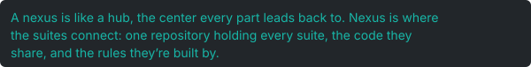

- `#808080` A header link under the pointer (dimmed, no box); text on the hover color, and its dimmed text.

  

- `#010101` Ink: a button's text on hover in the dark sections.

  

Background colors:

| Color | Hex | Used for |
| --- | --- | --- |
|  | `#010101` | Ink: the page background, the header, the dark sections, the footer and its notice strip. |
|  | `#0f0f0f` | Main color: Material's primary color, table headings. |
|  | `#17b6a7` | Teal: the hover color of links and buttons, the outline on linked pictures. |
|  | `#8080801a` | The hover color's faint fill behind what is under the pointer (10 %). |
|  | `#c0c0c0` | Silver: a button's fill under the pointer in the dark sections. |
|  | `#ffffff` | The main color's lighter and darker steps, for Material. |
|  | `#00000040` | The shadow under a button under the pointer (25 %). |

### Nexus Releases

The window of Nexus's app (`dev/releases/nexus_releases/style.py`): the page's colors as a theme for core's widgets, set with `create_app(theme=NEXUS)`; its states are the apps' state family.

Text colors:

- `#c0c0c0` Silver: the text, the title, the boxes' values and captions, the buttons, the tabs and the fields.

  

- `#010101` Ink: text on the teal accent (a selected row).

  

Background colors:

| Color | Hex | Used for |
| --- | --- | --- |
|  | `#010101` | Ink: the window, the header and the dialogs; the bottom of a button's or a box's sheen; every other row of a table. |
|  | `#0f0f0f` | Main color: the fields, lists and tables; the top of a button's or a box's sheen. |
|  | `#17b6a7` | Teal: the accent: the selection, the outline of a selected cell or a focused field, a button or pill under the pointer, the main action (Apply, Bump portal, Retract), the progress bar. |
|  | `#80808066` | Dimmed silver (40 %): the borders of the fields, boxes, tabs and buttons, and a box's neutral edge. |

## The apps' own colors

On top of the theme, in the apps' `style.py` or where they are used.

### Gaming apps

Console Link, Console LinkB, Decky, HD Control, PCSX2, PPSSPP, RPCS3, shadPS4, Vita3K and Xenia.

Text colors:

- `#5b93da` Links on a dark window (Console Link, Console LinkB, Decky, PCSX2, PPSSPP, RPCS3, shadPS4, Vita3K, Xenia; HD Control's lit parts).

  

- `#ffffff` Text on the blue primary button and on the shortcut artwork.

  

Background colors:

| Color | Hex | Used for |
| --- | --- | --- |
|  | `#0a55b0` | Gaming blue: the primary button, hover borders; the blue of the gaming apps' icon. |
|  | `#2a6cc4` | Gaming blue on hover. |
|  | `#08448d` | Gaming blue while pressed. |
|  | `#0a55b01a` | Blue tint (10 %): hover, every other table row. |
| 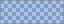 | `#0a55b059` | Blue line (35 %): outlines, a pressed button. |
|  | `#80808080` | Disabled (50 % gray). |
|  | `#5b93da` | HD Control: lit parts of the controller, the chosen card. |
|  | `#0b1d3a` | shadPS4 shortcut artwork, top of the gradient. |
|  | `#030810` | shadPS4 shortcut artwork, bottom. |
|  | `#16123a` | RPCS3 shortcut artwork, top. |
| 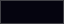 | `#05040f` | RPCS3 shortcut artwork, bottom. |
|  | `#0d2a4a` | PPSSPP shortcut artwork, top. |
|  | `#04080f` | PPSSPP shortcut artwork, bottom. |
| 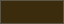 | `#3a2c0d` | Vita3K shortcut artwork, top. |
|  | `#0f0b03` | Vita3K shortcut artwork, bottom. |
|  | `#000000` | Console Link's stream view. |

### DatStation

Text colors:

- `#4da3ef` Links on a dark window.

  

- `#0072ce` Links on a light window.

  

- `#3dbf9c` Triangle: the Quiz symbol (the face-button colors, as HD Control draws them).

  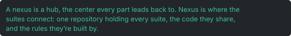

- `#e8505b` Circle: the History symbol.

  

- `#6f9fe8` Cross: the System Version History symbol.

  

- `#e48fc0` Square: the Region Codes symbol.

  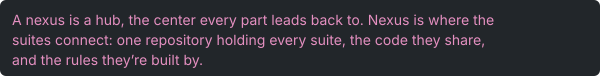

- `#ffd166` The PS News symbol.

  

- `#ffd700` Gold: the Scores & Trophies symbol, a perfect quiz, gold stars.

  

- `#c0c0c0` Silver stars.

  

- `#cd7f32` Bronze stars.

  

- `#2e7d32` Right answers: the count and the feedback.

  

- `#c62828` Wrong answers: the count; little time left.

  

Background colors:

| Color | Hex | Used for |
| --- | --- | --- |
|  | `#003791` | PlayStation blue. |
|  | `#0072ce` | PlayStation light blue: hover borders. |
|  | `#1a85e0` | Blue on hover. |
|  | `#00589f` | Blue while pressed. |
|  | `#2e7d32` | A right answer's button. |
|  | `#c62828` | A wrong answer's button. |

### Upscaler

Text colors:

- `#3fc8cf` Links on a dark window.

  

- `#0e6f75` Links on a light window.

  

Background colors:

| Color | Hex | Used for |
| --- | --- | --- |
|  | `#8a5a2e` | Copper: boxes, white text on them. |
|  | `#0e6f75` | Teal: boxes, white text on them. |
|  | `#26a9b0` | Cyan, the icon's: button outlines. |

### BC-250 Bazzite Test (check)

Text colors:

- `#9aa0a6` Muted: versions, hints, notes, baselines, the in-game and overlay labels.

  

- `#e6e6e6` Text in the results and history views, on idle buttons, the overlay's values.

  

- `#e8e8e8` Code blocks in the README view.

  

- `#d0d0d0` The log; a disabled Clean up logs button.

  

- `#1a1a1a` Text on the yellow running button.

  

- `#222222` Text on the system score boxes.

  

- `#333333` Labels on the graph's bars.

  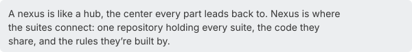

- `#e57373` Error findings; a worse result in the history; a low score; the log's errors; error labels (also in ACPI, CU Unlock and Cores Unlock); the in-game error.

  

- `#ffb74d` Warning findings; a middle score; the log's warnings; the in-game warning.

  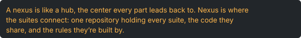

- `#64b5f6` Info and hint findings.

  

- `#81c784` A better result in the history; the log's success; a full score; the in-game ok.

  

- `#fdd835` A score's warning: the running yellow.

  

- `#ce93d8` Log: hint; the Show in log link; the in-game accent; the overlay's frame rate and thin border.

  

- `#90a4ae` Log: note.

  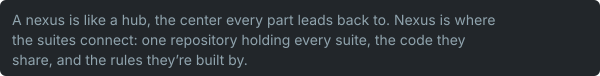

- `#ffffff` README table headings.

  

Background colors:

| Color | Hex | Used for |
| --- | --- | --- |
|  | `#111418` | The log; the overlay's background (82 %). |
| 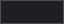 | `#1e1f24` | The results and history views; code blocks in the README view. |
|  | `#14161c` | The results card and the score dialog. |
|  | `#2a2d36` | The empty part of a score ring. |
|  | `#2a2f37` | The log's border. |
|  | `#3a3f4a` | The borders of the preview, setup, checks and stat cards. |
|  | `#555555` | The screenshot's border. |
|  | `#888888` | README table borders. |
|  | `#3a3f4b` | Idle buttons; README table headings; Clean up logs, disabled. |
|  | `#b71c1c` | Clean up logs under the pointer and pressed. |
|  | `#f8fafc` | The system score boxes. |
|  | `#1565c0` | The GPU score box: the info blue. |
|  | `#ad1457` | System overview: cores. |
|  | `#00796b` | System overview: threads. |
|  | `#3949ab` | System overview: upload speed. |
|  | `#6d4c41` | System overview: NVMe. |
|  | `#5e35b1` | System overview: packages. |
|  | `#00838f` | System overview: BIOS; the graph's sixth series. |
| 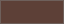 | `#5d4037` | The graph's seventh series. |

### Other apps

Text colors:

- `#888888` Busy and hint labels in italics (ACPI, CU Bisect, CU Unlock, Cores Bisect, Cores Unlock).

  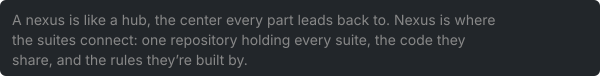

- `#ef6c00` An incomplete ACPI override; a CU mask that needs checking.

  

- `#b8b8c8` System Overlay: the names of the values.

  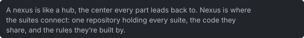

- `#dddddd` Console Link's stream view.

  

- `#ffb74d` SFTP: the password warning.

  

- `#e57373` SFTP: password requirements not met; NetcatGUI: error lines in the session.

  

- `#81c784` SFTP: password requirements met; NetcatGUI: success lines in the session.

  

- `#d2691e` NetcatGUI: HTTP and status replies.

  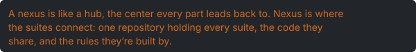

- `#3c7dd9` NetcatGUI: header names.

  

- `#8a8f98` NetcatGUI: byte counts.

  

- `#ffffff` BIOS Reader: tabs, crumbs, the legend and the selection.

  

- `#0b2a8a` BIOS Reader: the screen's text.

  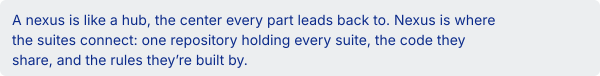

- `#10205a` BIOS Reader: subtitles.

  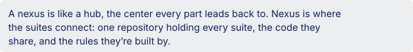

- `#6e6e6e` BIOS Reader: hidden items.

  

- `#7d7d8c` BIOS Reader: locked items.

  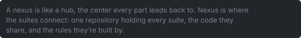

- `#2e7d32` Installer Tests: passed.

  

Background colors:

| Color | Hex | Used for |
| --- | --- | --- |
|  | `#1f3e9c` | BIOS Reader: the bar and the selection. |
|  | `#c6c6c6` | BIOS Reader: the screen. |
|  | `#1565c0` | HDMI-CEC: the adapter box. |
|  | `#000000` | HDMI-CEC: the display box; HD Control: the light bar off. |
|  | `#c62828` | SFTP: the errors button. |
|  | `#5f6368` | VRAM: firmware in the memory map. |
|  | `#00838f` | VRAM: zswap in the memory map. |
|  | `#3dbf9c` | HD Control: the triangle button. |
|  | `#e8505b` | HD Control: the circle button. |
|  | `#6f9fe8` | HD Control: the cross button. |
| 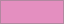 | `#e48fc0` | HD Control: the square button. |
|  | `#0050ff` | HD Control light bar: blue (the default). |
|  | `#ff2020` | Light bar: red. |
|  | `#10d040` | Light bar: green. |
|  | `#a020f0` | Light bar: purple. |
|  | `#ffffff` | Light bar: white. |
| 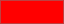 | `#ff0000` | The light bar's color wheel: red. |
|  | `#ffff00` | Color wheel: yellow. |
| 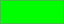 | `#00ff00` | Color wheel: green. |
|  | `#00ffff` | Color wheel: cyan. |
| 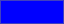 | `#0000ff` | Color wheel: blue. |
| 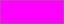 | `#ff00ff` | Color wheel: magenta. |
|  | `#d04545` | NetcatGUI tab: red. |
|  | `#e08a1e` | NetcatGUI tab: orange. |
|  | `#2e9e5b` | NetcatGUI tab: green. |
|  | `#3c7dd9` | NetcatGUI tab: blue. |
|  | `#8e5bd0` | NetcatGUI tab: purple. |
|  | `#8a8f98` | NetcatGUI tab: gray. |
|  | `#04060c` | Portal Big Picture: the backdrop. |
|  | `#1b1b1b` | Portal Big Picture: the outline of the update badge. |
|  | `#808080` | Portal Big Picture: a tab on hover (16 %). |

## Tools

### Portal screenshots

`bc250-bazzite/tools/portal_screenshot.py` paints the portal in a fixed dark palette (Breeze Dark, as Bazzite's desktop shows the portal), so screenshots look the same on every machine.

Text colors:

- `#fcfcfc` Window, field, button and tooltip text.

  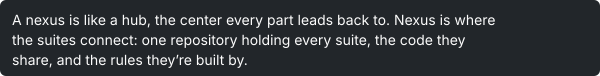

- `#a1a9b1` Placeholders.

  

- `#1d99f3` Links.

  

Background colors:

| Color | Hex | Used for |
| --- | --- | --- |
|  | `#202326` | Window. |
|  | `#141618` | Fields and lists. |
|  | `#1d1f22` | Every other row. |
|  | `#292c30` | Buttons and tooltips. |
|  | `#3daee9` | Selection. |
|  | `#43474d` | Mid. |
|  | `#33373b` | Midlight. |
|  | `#101113` | Dark. |
|  | `#3d4146` | Light. |
