# Design

The colours of the suite, where they are defined and what they are for. Text colours show a sample sentence in that
colour; background colours (surfaces, fills, borders and lines) show a block. The samples are SVG files in
`docs/design/colors/`. A text sample sits on a dark or a light backdrop, whichever its colour reads on; a colour with
an opacity (written `#rrggbbaa` here, `#aarrggbb` in the Qt code) shows over a checkerboard. The icons are in
[ICONS.md](ICONS.md). Written by `tools/make_design.py`: change the listing there and run it.

## The apps

The theme, the state colours and the style sheets are in `core/bc250_core/theme.py` (bundled per app; the apps that
are not on core yet carry a copy). The theme is one choice for every app: Gunmetal, Silver or Warm.

### Gunmetal (dark, the default)

Text colours:

- `#d9dde2` Text on every surface.

  

- `#82868b` Muted text: versions, hints, placeholders, disabled buttons (text and window mixed).

  

- `#ffffff` Text on the accent (selected rows and items).

  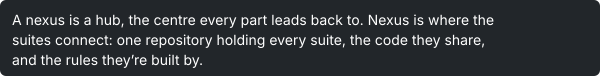

- `#7e97ad` Links.

  

Background colours:

| Colour | Hex | Used for |
| --- | --- | --- |
|  | `#2b2f34` | Window and dialog background; the selected tab. |
|  | `#22262a` | Text fields, lists, tables, tooltips, progress bars and scroll bars. |
|  | `#292d32` | Every other row of a list or table. |
|  | `#4a5058` | Button face, top of its sheen; scroll bar handles. |
|  | `#3b4048` | Button face, bottom of its sheen. |
|  | `#606872` | Palette light (the button face 30 % lighter). |
|  | `#14171a` | Borders and shadows. |
|  | `#7e97ad` | Accent: selection, focus, hover outline, progress, the selected tab's top edge. |

### Silver (light)

Text colours:

- `#1e2226` Text on every surface.

  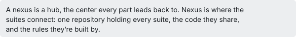

- `#7a7d81` Muted text: versions, hints, placeholders, disabled buttons.

  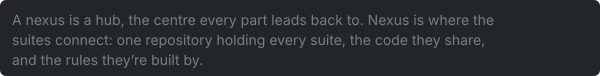

- `#ffffff` Text on the accent.

  

- `#5f7f9c` Links.

  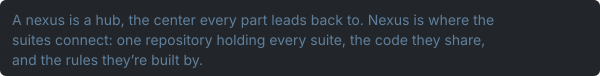

Background colours:

| Colour | Hex | Used for |
| --- | --- | --- |
|  | `#d5d8dc` | Window and dialog background; the selected tab. |
|  | `#eceef0` | Text fields, lists, tables, tooltips, progress bars and scroll bars. |
| 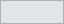 | `#e2e5e8` | Every other row of a list or table. |
|  | `#eef0f2` | Button face, top of its sheen; scroll bar handles. |
|  | `#c4c8cd` | Button face, bottom of its sheen. |
|  | `#ffffff` | Palette light (the button face 30 % lighter). |
|  | `#8d9298` | Borders and shadows. |
|  | `#5f7f9c` | Accent: selection, focus, hover outline, progress, the selected tab's top edge. |

### Warm (dark)

Text colours:

- `#e3dfd8` Text on every surface.

  

- `#8c8984` Muted text: versions, hints, placeholders, disabled buttons.

  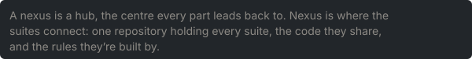

- `#1b1a18` Text on the accent.

  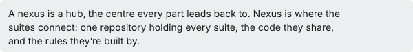

- `#b59a6e` Links.

  

Background colours:

| Colour | Hex | Used for |
| --- | --- | --- |
|  | `#35332f` | Window and dialog background; the selected tab. |
|  | `#292826` | Text fields, lists, tables, tooltips, progress bars and scroll bars. |
| 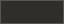 | `#302e2b` | Every other row of a list or table. |
|  | `#57534d` | Button face, top of its sheen; scroll bar handles. |
| 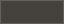 | `#45423d` | Button face, bottom of its sheen. |
|  | `#716c64` | Palette light (the button face 30 % lighter). |
|  | `#181716` | Borders and shadows. |
|  | `#b59a6e` | Accent: selection, focus, hover outline, progress, the selected tab's top edge. |

### State colours

The same in every theme: a state shows as a coloured edge or dot on the theme's surfaces.

Text colours:

- `#2e7d32` Green: Passed, a valid entry.

  

- `#c62828` Red: Failed, errors and problems in every app (the emulator managers' status lines, Suite Releases' bad tags, the upscaler's problems, a folder that is missing).

  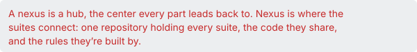

- `#ffffff` Bright text (palette BrightText); text on the state colours.

  

Background colours:

| Colour | Hex | Used for |
| --- | --- | --- |
| 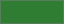 | `#2e7d32` | Green, ok: a state's edge or dot; an unlocked CU; a pressed controller button. |
| 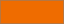 | `#ef6c00` | Orange, warn. |
| 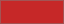 | `#c62828` | Red, bad; the red buttons of the bisect apps and of Clean up logs. |
|  | `#b71c1c` | The red buttons' hover (the bisect apps). |
|  | `#1565c0` | Blue, info. |
|  | `#3a3f4b` | Grey, neutral. |
|  | `#6a1b9a` | Purple, the logo's purple. |
| 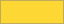 | `#fdd835` | Yellow, running: never confused with a failed (red) state. |
|  | `#8b0000` | Active red: the GPU Governor's active button. |
|  | `#a00000` | Active red on hover. |
|  | `#424242` | Off: a locked CU, a core without a state. |
|  | `#1d4f91` | Steam artwork: the accent when an icon gives no bright colour. |

## The wiki

`docs/stylesheets/suite.css`, Material's slate scheme with the suite's purple.

### Wiki

Text colours:

- `#ffffff` Header, hero, cards and footer text; table headings; buttons on the dark and accent sections.

  

- `#a98bff` Suite soft: links in the dark scheme; hover on the dark section; footer column headings.

  

- `#c9bfee` Suite mist: card text and footer links.

  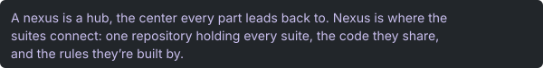

- `#1e1340` Suite deep: a button's text on hover in the dark and accent sections.

  

Background colours:

| Colour | Hex | Used for |
| --- | --- | --- |
| 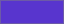 | `#5835ce` | Suite primary: Material's primary colour, table headings, page icons, the hero and Get started gradients. |
|  | `#7a5ce0` | Primary, light. |
|  | `#4426a8` | Primary, dark. |
|  | `#8a2be2` | Suite secondary: the accent (hover rings on linked images), the end of the gradients. |
| 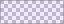 | `#8a2be21a` | The accent at 10 %. |
|  | `#1e1340` | Suite deep: header and tabs, the hero's top, the Download button. |
|  | `#120c22` | Suite ink: the dark section and the home page's footer; the hero pictures' shadow (45 %). |
|  | `#17141f` | Page background (the dark scheme). |
|  | `#8b4fd8` | The stage pill under the claim. |
|  | `#ffffff` | Button background on hover in the dark and accent sections; at 12 % behind the header links. |
|  | `#000000` | The footer's bottom bar (35 %); button shadows (25 %). |

## The apps' own colours

On top of the theme, in the apps' `style.py` or where they are used.

### Gaming apps

Console Link, Console LinkB, Decky, HD Control, PCSX2, PPSSPP, RPCS3, shadPS4, Vita3K and Xenia.

Text colours:

- `#5b93da` Links on a dark window (Console Link, Console LinkB, Decky, PCSX2, PPSSPP, RPCS3, shadPS4, Vita3K, Xenia; HD Control's lit parts).

  

- `#ffffff` Text on the blue primary button and on the shortcut artwork.

  

Background colours:

| Colour | Hex | Used for |
| --- | --- | --- |
|  | `#0a55b0` | Gaming blue: the primary button, hover borders; the blue of the gaming apps' icon. |
|  | `#2a6cc4` | Gaming blue on hover. |
|  | `#08448d` | Gaming blue while pressed. |
|  | `#0a55b01a` | Blue tint (10 %): hover, every other table row. |
|  | `#0a55b059` | Blue line (35 %): outlines, a pressed button. |
|  | `#80808080` | Disabled (50 % grey). |
| 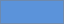 | `#5b93da` | HD Control: lit parts of the controller, the chosen card. |
|  | `#0b1d3a` | shadPS4 shortcut artwork, top of the gradient. |
| 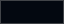 | `#030810` | shadPS4 shortcut artwork, bottom. |
| 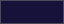 | `#16123a` | RPCS3 shortcut artwork, top. |
|  | `#05040f` | RPCS3 shortcut artwork, bottom. |
|  | `#0d2a4a` | PPSSPP shortcut artwork, top. |
|  | `#04080f` | PPSSPP shortcut artwork, bottom. |
|  | `#3a2c0d` | Vita3K shortcut artwork, top. |
|  | `#0f0b03` | Vita3K shortcut artwork, bottom. |
|  | `#000000` | Console Link's stream view. |

### DatStation

Text colours:

- `#4da3ef` Links on a dark window.

  

- `#0072ce` Links on a light window.

  

- `#48b67e` Triangle: the Quiz symbol.

  

- `#e24c4c` Circle: the History symbol.

  

- `#5aa0ff` Cross: the System Version History symbol.

  

- `#e07ab8` Square: the Region Codes symbol.

  

- `#ffd166` The PS News symbol.

  

- `#ffd700` Gold: the Scores & Trophies symbol, a perfect quiz, gold stars.

  

- `#c0c0c0` Silver stars.

  

- `#cd7f32` Bronze stars.

  

- `#2e7d32` Right answers: the count and the feedback.

  

- `#c62828` Wrong answers: the count; little time left.

  

Background colours:

| Colour | Hex | Used for |
| --- | --- | --- |
|  | `#003791` | PlayStation blue. |
|  | `#0072ce` | PlayStation light blue: hover borders. |
|  | `#1a85e0` | Blue on hover. |
|  | `#00589f` | Blue while pressed. |
|  | `#2e7d32` | A right answer's button. |
|  | `#c62828` | A wrong answer's button. |

### Upscaler

Text colours:

- `#3fc8cf` Links on a dark window.

  

- `#0e6f75` Links on a light window.

  

Background colours:

| Colour | Hex | Used for |
| --- | --- | --- |
| 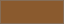 | `#8a5a2e` | Copper: boxes, white text on them. |
|  | `#0e6f75` | Teal: boxes, white text on them. |
|  | `#26a9b0` | Cyan, the icon's: button outlines. |

### BC-250 Bazzite Test (check)

Text colours:

- `#9aa0a6` Muted: versions, hints, notes, baselines, the in-game and overlay labels.

  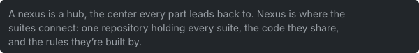

- `#e6e6e6` Text in the results and history views, on idle buttons, the overlay's values.

  

- `#e8e8e8` Code blocks in the README view.

  

- `#d0d0d0` The log; a disabled Clean up logs button.

  

- `#1a1a1a` Text on the yellow running button.

  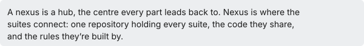

- `#222222` Text on the system score boxes.

  

- `#333333` Labels on the graph's bars.

  

- `#e57373` Error findings; a worse result in the history; a low score.

  

- `#ffb74d` Warning findings; a middle score.

  

- `#64b5f6` Info and hint findings.

  

- `#b39ddb` The Show in log link.

  

- `#81c784` A better result in the history.

  

- `#66bb6a` Log: success; a full score.

  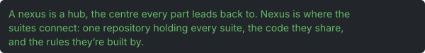

- `#ffd600` A score's yellow.

  

- `#ffa726` Log: warning.

  

- `#ef5350` Log: error; error labels (also in ACPI, CU Unlock and Cores Unlock).

  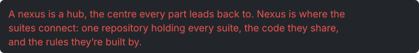

- `#ce93d8` Log: hint.

  

- `#90a4ae` Log: note.

  

- `#8b4fd8` In-game: the accent text.

  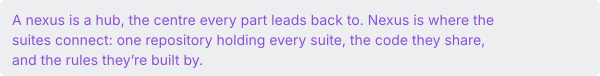

- `#6ec46e` In-game: check ok.

  

- `#e0a53a` In-game: check warning.

  

- `#e06c6c` In-game: check error.

  

- `#b388ff` Overlay: the frame rate and the thin border.

  

- `#ffffff` README table headings.

  

Background colours:

| Colour | Hex | Used for |
| --- | --- | --- |
|  | `#111418` | The log; the overlay's background (82 %). |
|  | `#1e1f24` | The results and history views; code blocks in the README view. |
|  | `#14161c` | The results card and the score dialog. |
|  | `#2a2d36` | The empty part of a score ring. |
|  | `#2a2f37` | The log's border. |
|  | `#3a3f4a` | The borders of the preview, setup, checks and stat cards. |
|  | `#555555` | The screenshot's border. |
|  | `#888888` | README table borders. |
|  | `#3a3f4b` | Idle buttons; README table headings. |
|  | `#f8fafc` | The system score boxes. |
| 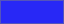 | `#2828f6` | The GPU score box. |
|  | `#ad1457` | System overview: cores. |
|  | `#00796b` | System overview: threads. |
|  | `#3949ab` | System overview: upload speed. |
|  | `#6d4c41` | System overview: NVMe. |
|  | `#5e35b1` | System overview: packages. |
|  | `#00838f` | System overview: BIOS; the graph's sixth series. |
|  | `#5d4037` | The graph's seventh series. |
|  | `#e53935` | Clean up logs on hover. |
|  | `#a31515` | Clean up logs while pressed. |
| 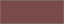 | `#7a4a4a` | Clean up logs, disabled. |

### Other apps

Text colours:

- `#888888` Busy and hint labels in italics (ACPI, CU Bisect, CU Unlock, Cores Bisect, Cores Unlock).

  

- `#ef6c00` An incomplete ACPI override; a CU mask that needs checking.

  

- `#b8b8c8` System Overlay: the names of the values.

  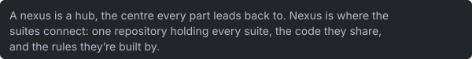

- `#dddddd` Console Link's stream view.

  

- `#e5a400` SFTP: the password warning.

  

- `#e74c3c` SFTP: password requirements not met.

  

- `#27ae60` SFTP: password requirements met.

  

- `#2e9e5b` NetcatGUI: success lines in the session.

  

- `#d2691e` NetcatGUI: HTTP and status replies.

  

- `#d04545` NetcatGUI: error lines.

  

- `#3c7dd9` NetcatGUI: header names.

  

- `#8a8f98` NetcatGUI: byte counts.

  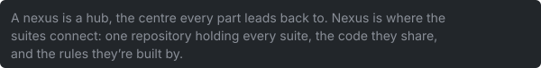

- `#ffffff` BIOS Reader: tabs, crumbs, the legend and the selection.

  

- `#0b2a8a` BIOS Reader: the screen's text.

  

- `#10205a` BIOS Reader: subtitles.

  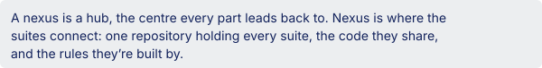

- `#6e6e6e` BIOS Reader: hidden items.

  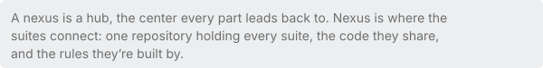

- `#7d7d8c` BIOS Reader: locked items.

  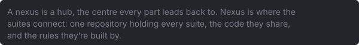

- `#16803c` Installer Tests: passed.

  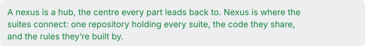

Background colours:

| Colour | Hex | Used for |
| --- | --- | --- |
|  | `#1f3e9c` | BIOS Reader: the bar and the selection. |
|  | `#c6c6c6` | BIOS Reader: the screen. |
|  | `#0d47a1` | HDMI-CEC: the adapter box. |
|  | `#000000` | HDMI-CEC: the display box; HD Control: the light bar off. |
|  | `#e5484d` | SFTP: the errors button. |
|  | `#5f6368` | VRAM: firmware in the memory map. |
|  | `#00838f` | VRAM: zswap in the memory map. |
|  | `#3dbf9c` | HD Control: the triangle button. |
|  | `#e8505b` | HD Control: the circle button. |
|  | `#6f9fe8` | HD Control: the cross button. |
|  | `#e48fc0` | HD Control: the square button. |
|  | `#0050ff` | HD Control light bar: blue (the default). |
| 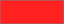 | `#ff2020` | Light bar: red. |
|  | `#10d040` | Light bar: green. |
| 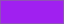 | `#a020f0` | Light bar: purple. |
|  | `#ffffff` | Light bar: white. |
|  | `#ff0000` | The light bar's colour wheel: red. |
| 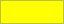 | `#ffff00` | Colour wheel: yellow. |
|  | `#00ff00` | Colour wheel: green. |
| 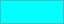 | `#00ffff` | Colour wheel: cyan. |
|  | `#0000ff` | Colour wheel: blue. |
|  | `#ff00ff` | Colour wheel: magenta. |
| 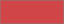 | `#d04545` | NetcatGUI tab: red. |
|  | `#e08a1e` | NetcatGUI tab: orange. |
|  | `#2e9e5b` | NetcatGUI tab: green. |
|  | `#3c7dd9` | NetcatGUI tab: blue. |
| 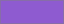 | `#8e5bd0` | NetcatGUI tab: purple. |
|  | `#8a8f98` | NetcatGUI tab: grey. |
|  | `#04060c` | Portal Big Picture: the backdrop. |
| 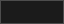 | `#1b1b1b` | Portal Big Picture: the outline of the update badge. |
|  | `#808080` | Portal Big Picture: a tab on hover (16 %). |

## Tools

### Portal screenshots

`tools/portal_screenshot.py` paints the portal in a fixed dark palette (Breeze Dark, as Bazzite's desktop shows the portal), so screenshots look the same on every machine.

Text colours:

- `#fcfcfc` Window, field, button and tooltip text.

  

- `#a1a9b1` Placeholders.

  

- `#1d99f3` Links.

  

Background colours:

| Colour | Hex | Used for |
| --- | --- | --- |
|  | `#202326` | Window. |
|  | `#141618` | Fields and lists. |
|  | `#1d1f22` | Every other row. |
|  | `#292c30` | Buttons and tooltips. |
| 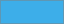 | `#3daee9` | Selection. |
|  | `#43474d` | Mid. |
| 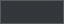 | `#33373b` | Midlight. |
|  | `#101113` | Dark. |
|  | `#3d4146` | Light. |
