# Design

The colors of Nexus, core's themes and the Windows Portable Suite, where they are defined and what they are for. Text colors show a sample sentence in that
color; background colors (surfaces, fills, borders and lines) show a block. The samples are SVG files in
`design/colors/`. A text sample sits on a dark or a light backdrop, whichever its color reads on; a color with
an opacity (written `#rrggbbaa` here, `#aarrggbb` in the Qt code) shows over a checkerboard. The icons are in
[ICONS.md](ICONS.md). Written by `tools/make_design.py`: change the listing there and run it.

The rules say what makes each design recognizable; the listings after them say where every color is used. The
BC250 Bazzite Suite's design is in its own repository's DESIGN.md (it moved there on 14-11-2026).

## The rules

A design is recognizable by a few colors used the same way everywhere, not by a palette of every color there is.
Each design (a suite's, the Nexus page's) has its own; none is carried over to another.

### Windows Portable Suite

- **The identity** (owner, 26-10-2026: direction D, B's amber on C's cards): a near-black window `#121214`, cards a
  step lighter `#1d1e22`, the focused card raised `#292b31`, one amber `#f5a524` for the focus and every pill
  in `#cd8b22` (owner, 29-10-2026); text `#f5f4f0` with dimmed `#a5a5ab` for the second line. Inter, with
  heavy titles. From `core/bc250_core/portable.py`, a theme for core's widgets set with `create_app(theme=PORTABLE)`.
- **The focus is what a controller needs to see** (owner, 29-10-2026: "hardly visible where you are"): the focused
  card is raised with an amber edge and an amber glow under it. When the focus moves into the pane at the right, the
  pane takes the edge and the glow, and its card keeps the edge without the glow; back on the cards, the pane is
  plain again. In a list the focused row is lighter `#3a3d45` with the amber edge. Cards and pills share the corner
  radius 14.
- **One kind of pill, in popups only** (owner, 29-10-2026): `#cd8b22` with a dark label, the same height and
  minimum width, in a row at the bottom right of the popup with the A pill rightmost; a pane holds none, every action
  being in the legend. Focused or under the pointer it is dimmed. Nothing is grayed out: what cannot act says why
  (owner, 29-10-2026). The glyph paints its own circle (a stylesheet's radius showed a square on the Ally).
- **The legend at the bottom is the row of actions** (owner, 29-10-2026): every action is an entry there, A too
  (A Steam mark, Y Update Steam, LB Folders, RB Steam artwork), its glyph gray, and every legend ends with the shared
  ones: ☰ Info (the pane's information), B Back (while B can act) and ⧉ Exit; a tap on an entry does what the
  button does. The information icon at a pane's top right is touch only, a ring with its sign.
- **A tile is a card with an icon** (the portal's apps, 28-10-2026): the app's icon centered above its name and
  its status, two rows of four under the category tabs; a status that asks for something (an update, a reinstall,
  an install running) is amber, the rest dimmed. The strip under the tiles is the detail pane, flat, with the
  focused app's pills at its right.

### Nexus

- **The identity:** near-black ink `#010101`, silver text `#c0c0c0` and one teal `#17b6a7` (the icon's) for every
  link, title and icon; nothing else. Inter, with heavy titles. Nexus is not a suite: the page has no apps and no
  states. Its one app, Nexus Release Tool (`dev/nrt/`, owner, 26-10-2026: a Nexus app takes Nexus's design), has
  this design in its window (`nexus_release_tool/style.py`, a theme for core's widgets: ink surfaces, silver text, the
  teal accent) and the Nexus icon; its states (the working tree, a build) are the apps' state family, since a build
  passes or fails there too.

## Core's themes

The theme, the state colors and the style sheets are in `core/bc250_core/theme.py` (bundled per app). The theme is
one choice for every app on it: Gunmetal, Silver or Warm.

### Gunmetal (dark, the default)

Text colors:

- `#d9dde2` Text on every surface.

  

- `#82868b` Muted text: versions, hints, placeholders, disabled buttons (text and window mixed).

  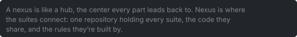

- `#ffffff` Text on the accent (selected rows and items).

  

- `#7e97ad` Links.

  

Background colors:

| Color | Hex | Used for |
| --- | --- | --- |
|  | `#2b2f34` | Window and dialog background; the selected tab. |
|  | `#22262a` | Text fields, lists, tables, tooltips, progress bars and scroll bars. |
|  | `#292d32` | Every other row of a list or table. |
| 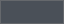 | `#4a5058` | Button face, top of its sheen; scroll bar handles. |
| 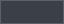 | `#3b4048` | Button face, bottom of its sheen. |
|  | `#606872` | Palette light (the button face 30 % lighter). |
|  | `#14171a` | Borders and shadows. |
| 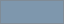 | `#7e97ad` | Accent: selection, progress. |
|  | `#c0c4c9` | Silver outline: the border under the mouse, with the focus and of the chosen tab or item (owner, 05-11-2026). |

### Silver (light)

Text colors:

- `#1e2226` Text on every surface.

  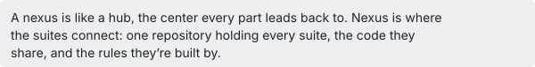

- `#7a7d81` Muted text: versions, hints, placeholders, disabled buttons.

  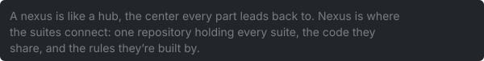

- `#ffffff` Text on the accent.

  

- `#5f7f9c` Links.

  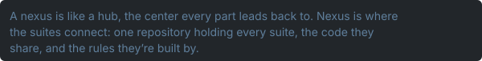

Background colors:

| Color | Hex | Used for |
| --- | --- | --- |
| 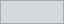 | `#d5d8dc` | Window and dialog background; the selected tab. |
| 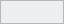 | `#eceef0` | Text fields, lists, tables, tooltips, progress bars and scroll bars. |
|  | `#e2e5e8` | Every other row of a list or table. |
|  | `#eef0f2` | Button face, top of its sheen; scroll bar handles. |
|  | `#c4c8cd` | Button face, bottom of its sheen. |
|  | `#ffffff` | Palette light (the button face 30 % lighter). |
|  | `#8d9298` | Borders and shadows. |
|  | `#5f7f9c` | Accent: selection, progress. |
|  | `#7d8389` | Silver outline, darker on the light theme: the border under the mouse, with the focus and of the chosen tab or item. |

### Warm (dark)

Text colors:

- `#e3dfd8` Text on every surface.

  

- `#8c8984` Muted text: versions, hints, placeholders, disabled buttons.

  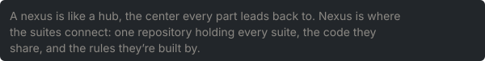

- `#1b1a18` Text on the accent.

  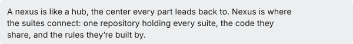

- `#b59a6e` Links.

  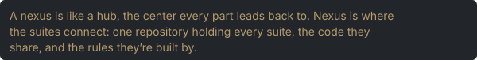

Background colors:

| Color | Hex | Used for |
| --- | --- | --- |
| 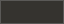 | `#35332f` | Window and dialog background; the selected tab. |
|  | `#292826` | Text fields, lists, tables, tooltips, progress bars and scroll bars. |
| 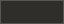 | `#302e2b` | Every other row of a list or table. |
|  | `#57534d` | Button face, top of its sheen; scroll bar handles. |
| 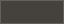 | `#45423d` | Button face, bottom of its sheen. |
|  | `#716c64` | Palette light (the button face 30 % lighter). |
| 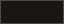 | `#181716` | Borders and shadows. |
| 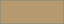 | `#b59a6e` | Accent: selection, progress. |
|  | `#c0c4c9` | Silver outline: the border under the mouse, with the focus and of the chosen tab or item (owner, 05-11-2026). |

### State colors

The same in every theme: a state shows as a colored edge or dot on the theme's surfaces.

Text colors:

- `#2e7d32` Green: Passed, a valid entry.

  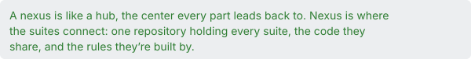

- `#c62828` Red: Failed, errors and problems in every app (the emulator managers' status lines, the Nexus Release Tool's bad tags, the upscaler's problems, a folder that is missing).

  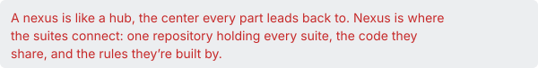

- `#ffffff` Bright text (palette BrightText); text on the state colors.

  

Background colors:

| Color | Hex | Used for |
| --- | --- | --- |
| 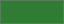 | `#2e7d32` | Green, ok: a state's edge or dot; an unlocked CU; a pressed controller button. |
| 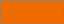 | `#ef6c00` | Orange, warn. |
| 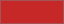 | `#c62828` | Red, bad; the red buttons of the bisect apps and of Clean up logs. |
|  | `#b71c1c` | The red buttons under the pointer or pressed (the bisect apps, Clean up logs). |
|  | `#1565c0` | Blue, info. |
|  | `#3a3f4b` | Gray, neutral. |
|  | `#6a1b9a` | Purple, the logo's purple. |
| 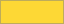 | `#fdd835` | Yellow, running: never confused with a failed (red) state. |
|  | `#8b0000` | Active red: the GPU Governor's active button. |
|  | `#a00000` | Active red on hover. |
|  | `#424242` | Off: a locked CU, a core without a state. |
|  | `#1d4f91` | Steam artwork: the accent when an icon gives no bright color. |

## The Windows Portable Suite

`core/bc250_core/portable.py`, the portable window: direction D (the owner's, 26-10-2026).

### Portable window

The apps of the Windows Portable Suite, sized for a handheld held in the hands.

Text colors:

- `#f5f4f0` The text: the title, a card's title, the values, the legend and a gray pill's label.

  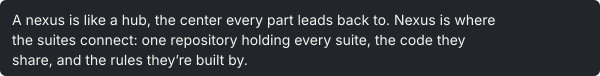

- `#a5a5ab` Dimmed: the version under the title, the line under a card's title, the labels of the values, the status line.

  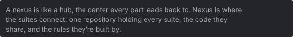

- `#f5a524` Amber: an update in a tile or the detail pane, the selected tab.

  

- `#cd8b22` The main pill's glyph letter, its pill's color.

  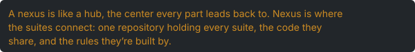

- `#141414` On the amber and the main pill: the main pill's label, a glyph on the amber.

  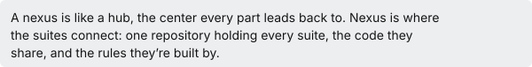

- `#ff1f1f` Hard red: the Turbo letter in the portal's status line, extra bold (owner, 31-10-2026).

  

Background colors:

| Color | Hex | Used for |
| --- | --- | --- |
| 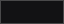 | `#121214` | The window, behind everything; a disabled pill's glyph circle. |
|  | `#1d1e22` | A card, the detail pane, a field or list. |
|  | `#292b31` | The focused card, a list's row, a disabled pill, a glyph's circle in the legend. |
|  | `#3a3d45` | The focused row of a list (owner, 29-10-2026), with the amber edge. |
|  | `#35383f` | Borders of fields and lists; a row under the pointer. |
| 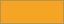 | `#f5a524` | Amber: the focused card's edge and the glow under it, the edge and glow of the pane the focus is in, the focused row's edge, the selected tab's line. |
| 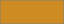 | `#cd8b22` | Every pill (owner, 29-10-2026: one kind of pill), and its glyph's letter. |
|  | `#141414` | A pill's label and its glyph's circle. |

### Wiki

`windows-portable/docs/stylesheets/portable.css`: the portable window's colors on Material's slate scheme.

Text colors:

- `#f5f4f0` The text: the pages, the header's name and links, table headings; on the home page the words under the handheld, the dark sections' text and card titles, the footer's name.

  

- `#a5a5ab` Dimmed: the stage note and the card text on the home page, the footer's links, the search field's hint.

  

- `#f5a524` Amber: links in the text, a header link under the pointer, the icons on the home page's cards, the footer's column headings, the Download button's text.

  

- `#141414` Text on the amber: the stage pill, Get started.

  

Background colors:

| Color | Hex | Used for |
| --- | --- | --- |
|  | `#121214` | The page and the header, as the window; the Download button, the footer's notice strip. |
|  | `#1d1e22` | Code blocks, the home page's dark sections and its footer, as a card. |
|  | `#292b31` | Table headings and Material's main color, as a focused card. |
|  | `#35383f` | Lines: the header's bottom edge, between a table's rows, between the questions of the FAQ. |
|  | `#f5a524` | Amber: links and buttons under the pointer, the outline on linked pictures, the main color's lighter step; the stage pill and the start of Get started's gradient on the home page. |
|  | `#cd8b22` | The main color's darker step: the main pill's amber; the end of Get started's gradient. |
| 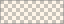 | `#f5a5241a` | A faint amber behind what is under the pointer (10 %). |
| 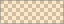 | `#f5a52440` | The amber glow under the handheld on the home page and under a button under the pointer (25 %), as under a focused card; behind code in Get started. |

## The Nexus page

`nexus/docs/stylesheets/nexus.css`, ink, silver and teal (the owner's design, 25-10-2026): the Nexus page has a
design of its own, apart from the suites' (a design per system).

### Nexus

Text colors:

- `#c0c0c0` Silver: the header's links, table headings, the text, card titles, links and buttons of the dark sections, card text, the stage note, footer links, License and Disclaimer; text on the main color and the search field's hint.

  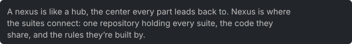

- `#17b6a7` Teal: links in the text, the icons on the home page's cards, the words at the top (the name and the claim), footer column headings, the footer's name and a footer link under the pointer, a dark section's link under the pointer, the text of the Nexus index button.

  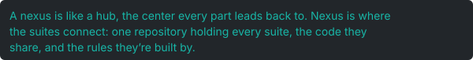

- `#808080` A header link under the pointer (dimmed, no box); text on the hover color, and its dimmed text.

  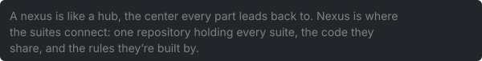

- `#010101` Ink: a button's text on hover in the dark sections; text, links and buttons on the teal (the stage pill, Get started).

  

Background colors:

| Color | Hex | Used for |
| --- | --- | --- |
|  | `#010101` | Ink: the page background, the header, the dark sections, the footer and its notice strip; the Nexus index button and a button under the pointer in Get started. |
| 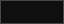 | `#0f0f0f` | Main color: Material's primary color, table headings. |
| 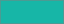 | `#17b6a7` | Teal: the hover color of links and buttons, the outline on linked pictures; the stage pill and Get started on the home page. |
| 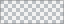 | `#8080801a` | The hover color's faint fill behind what is under the pointer (10 %). |
| 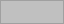 | `#c0c0c0` | Silver: a button's fill under the pointer in the dark sections. |
|  | `#ffffff` | The main color's lighter and darker steps, for Material. |
| 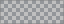 | `#00000040` | The shadow under a button under the pointer (25 %). |
| 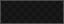 | `#010101e6` | The page dimmed behind the home page's video (90 %). |

### Nexus Release Tool

The window of Nexus's app (`dev/nrt/nexus_release_tool/style.py`): the page's colors as a theme for core's widgets, set with `create_app(theme=NEXUS)`; its states are the apps' state family.

Text colors:

- `#c0c0c0` Silver: the text, the title, the boxes' values and captions, the buttons, the tabs and the fields.

  

- `#010101` Ink: text on the teal accent (a selected row).

  

Background colors:

| Color | Hex | Used for |
| --- | --- | --- |
|  | `#010101` | Ink: the window, the header and the dialogs; the bottom of a button's or a box's sheen; every other row of a table. |
|  | `#0f0f0f` | Main color: the fields, lists and tables; the top of a button's or a box's sheen. |
|  | `#17b6a7` | Teal: the accent: the selection, the outline of a selected cell or a focused field, a button or pill under the pointer, the main action (Apply, Bump portal, Retract), the progress bar. |
| 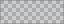 | `#80808066` | Dimmed silver (40 %): the borders of the fields, boxes, tabs and buttons, and a box's neutral edge. |
