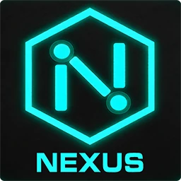
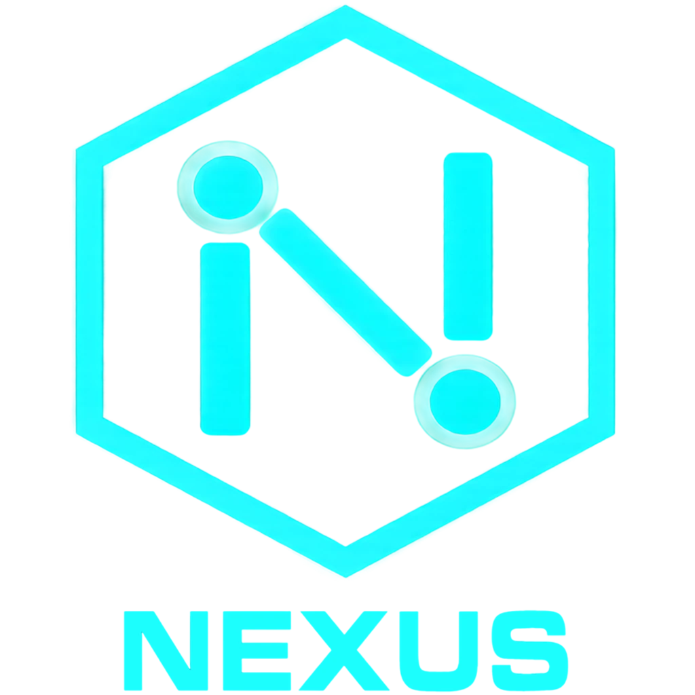
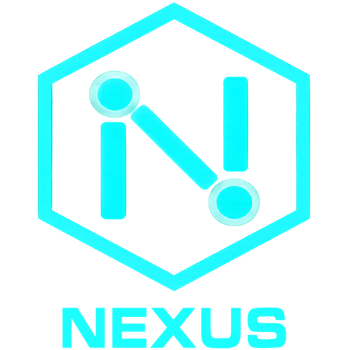

# Icons

The icons of Nexus, and where each is used. Written by `tools/make_icons.py`: change the listing there and run it.
Each suite lists its own icons in its own repository's `ICONS.md`.

## Nexus

### The Nexus icon

| Icon | File | Used for |
| --- | --- | --- |
|  | `nexus/images/nexus-<size>.png` (1024, 512, 256 and 128 px) | The icon of Nexus, the owner's drawing (25-10-2026): the set the copies are made from. |
|  | `nexus/docs/images/nexus.webp`, `.png` (256 px) | The Nexus page's header logo and its home page's footer (`.webp`), and its favicon (`.png`): the 256 px drawing, transparent (owner, 27-10-2026: no more dark tile), both written by this tool. |
|  | `nexus/docs/images/nexus-hero.webp` (1024 px) | The Nexus page's home: the icon under the headline, a WebP copy of the 1024 px drawing. |
|  | `dev/<name>/images/<app id>.webp` (512 px), `-128.png` | The Nexus apps (owner, 26-10-2026: a Nexus app takes Nexus's icon, not a category's): Nexus Dashboard (`dev/dash`), Nexus Release Tool (`dev/nrt`), Nexus Demo Recorder (`dev/demo`), Nexus Installer Tests (`dev/itests`), Nexus Sound Lab (`dev/sounds`) and Nexus Deps (`dev/deps`), each its window header and window icon, its menu entry and Desktop icon. Lossless copies of the drawing, written by this tool. |

### Material Design icons on the Nexus page

Drawn by MkDocs Material in the page's colors.

| Icon | Name | Used for |
| --- | --- | --- |
|  | `material-file-tree` | Home: the card "Nexus". |
|  | `material-view-grid` | Home: the card "A suite". |
|  | `material-application` | Home: the card "An app". |
|  | `material-chip` | Home: the card "BC250 Bazzite Suite". |
|  | `material-controller` | Home: the card "Windows Portable Suite". |
|  | `material-download` | Home: the Nexus index button. |

### Symbols in text

Characters of the font, used as icons in the Nexus apps' labels and buttons.

| Symbol | App | Used for |
| --- | --- | --- |
| ✓ ✗ | Nexus Deps | CVE: none found, found. |
| ↑ ↓ | Nexus Release Tool | Earlier commands, in the command line's placeholder. |
| ● | Every app on core | The dot of a status box (`bc250_core/widgets.py`). |
| ✓ ✗ | Nexus Installer Tests | A test passed, failed. |
