# Icons

The icons of the project, per suite, and where each is used. Pictures are shown from their own files; icons drawn
in code are rendered to `bc250-bazzite/docs/design/icons/`. Written by `tools/make_icons.py`: change the listing
there and run it. The paths of the BC250 Bazzite Suite's section are relative to its folder, `bc250-bazzite/`.

## BC250 Bazzite Suite

### The suite's icon

| Icon | File | Used for |
| --- | --- | --- |
| 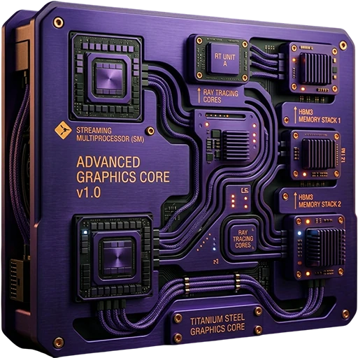 | `portal/images/bc250-bazzite-suite.webp` (512 px) | The portal's window header (a click opens the wiki) and its window icon; Suite Big Picture Mode's header; the portal's release in Nexus Releases. |
| 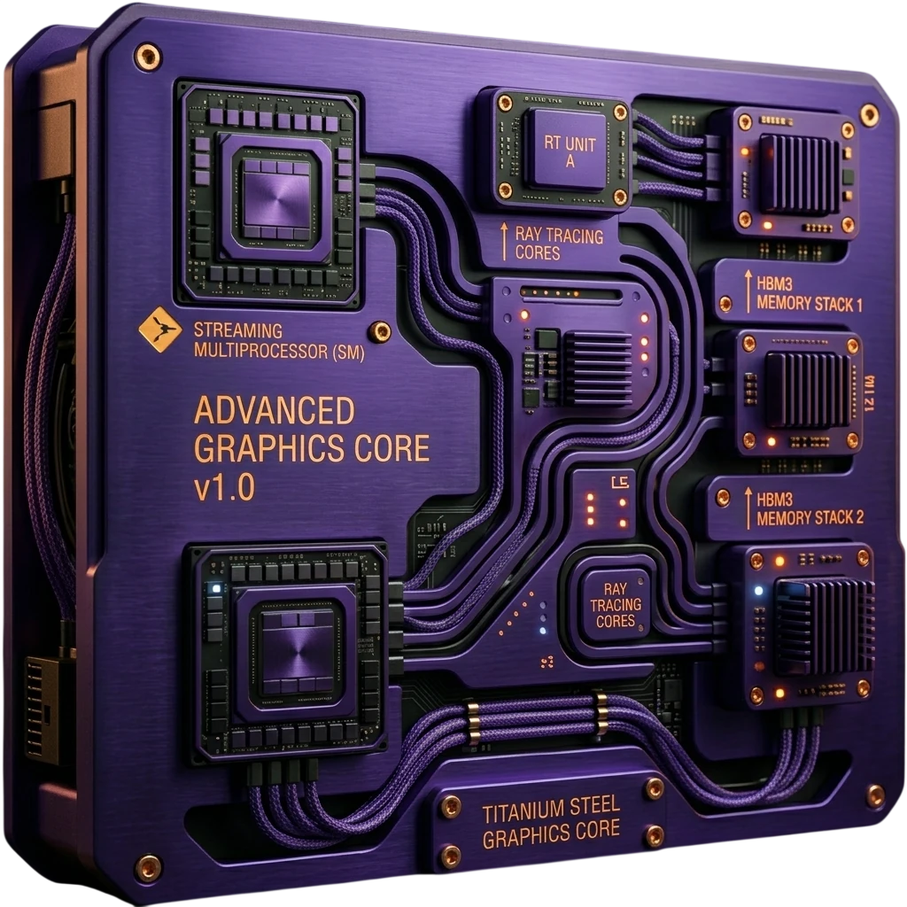 | `portal/images/bc250-bazzite-suite-1024.webp` | The intro of Suite Big Picture Mode. |
| 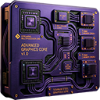 | `portal/images/bc250-bazzite-suite-128.png` | The portal's menu entry and Desktop icon. |
| 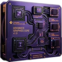 | `portal/images/apps/portal.webp` (128 px) | The portal's own tile. |
|  | `docs/images/wiki-icon.webp`, `.png` | The wiki's header logo, its home page's footer and its favicon. |

### The category icons

Every app has the icon of its category: `icons/categories.toml` assigns them, `tools/sync_icons.py` copies each
category's icon (`icons/<category>/`, at 1024, 512, 256 and 128 px) to these places:

- `apps/<app>/images/<icon>.webp` (512 px): the app's window header (96 px), its window and tray icon, and the
  logo at the top of its chapter in the wiki.
- `apps/<app>/images/<icon>-128.png`: the app's menu entry and Desktop icon.
- `portal/images/apps/<key>.webp` (256 px): the app's tile in the portal, and its icon in the wiki's app tables.
- `portal/images/categories/<category>.webp` (512 px): the category in Suite Big Picture Mode.
- In the wiki, the category's own icon (256 px) in the table of categories.

| Icon | Category | Apps |
| --- | --- | --- |
|  | Development | BC-250 Installer Tests (`installer-tests`) |
| 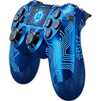 | Gaming | RPCS3 Manager (`rpcs3`) Console Link (`consoles`) Console LinkB (`clb`) shadPS4 Manager (`shadps4`) Decky Loader Manager (`decky`) Bazzite DatStation (`datstation`) PPSSPP Manager (`ppsspp`) PCSX2 Manager (`pcsx2`) Xenia Manager (`xenia`) Vita3K Manager (`vita3k`) |
| 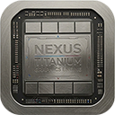 | Graphics | BC-250 Upscaler Manager (`upscaler`) BC-250 ACE Queues (`ace`) BC-250 Mesh Shaders (`mesh`) |
| 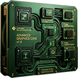 | Sustainable | BC-250 Bazzite Test (`check`) BC-250 GPU Governor Manager (`gpu`) BC-250 CU Bisect (`compute`) CU Unlock (the CU Bisect app's Unlock) (`cu-unlock`) BC-250 Cores Bisect (`cores`) Cores Unlock (the Cores Bisect app's Unlock) (`cores-unlock`) BC-250 GPU OC Bisect (`oc`) BC-250 Persistent ACPI (`acpi`) BC-250 Memory Manager (`vram`) BC-250 Fan Control (`fan`) |
| 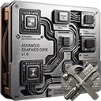 | Utilities | System Overlay (`overlay`) BC-250 BIOS Reader (`bios`) BC-250 USB Wi-Fi (`wdriver`) HDMI CEC Manager (`cec`) Bazzite SFTP Tools (`sftp`) USB IPS3.5 (`ips35`) USB HD Cam (`hdcam`) USB HD Control (`hdcontrol`) Media Tool (`mtool`) Dependency Checker (`package`) Bazzite NetcatGUI (`ncgui`) |

### The portal's symbols

Drawn with QPainter in `portal/bc250_portal/glyphs.py`, in the theme's text color (shown here on Gunmetal) or red.

| Icon | Name | Used for |
| --- | --- | --- |
|  | Install | An app's install button: an arrow down into a tray. |
|  | Install, update | The same button in red when an update is waiting. |
|  | Reinstall | The install button of an app whose version the portal does not know (red), a circular arrow. |
|  | Reinstall badge | On a tile, in the portal and in Suite Big Picture Mode: the app needs a reinstall. |
|  | Uninstall | An app's uninstall button: a waste bin. |

### Icons in the apps

| Icon | File | Used for |
| --- | --- | --- |
|  | `apps/ncgui/images/icons/connect.png` | Bazzite NetcatGUI: Connect (the Silk icons of the original tool, CC-BY 2.5, Mark James). |
|  | `apps/ncgui/images/icons/listen.png` | Bazzite NetcatGUI: Listen. |
|  | `apps/ncgui/images/icons/save.png` | Bazzite NetcatGUI: Save. |
|  | `apps/<app>/<package>/arrow-down.svg` | The arrow of a choice box in PCSX2 Manager, RPCS3 Manager and shadPS4 Manager (a copy in each). |

### The desktop style's icons

Icons the apps take from the desktop's style or icon theme, so they look different on every desktop; shown here as
Qt's Fusion style draws them.

| Icon | Name | Used for |
| --- | --- | --- |
|  | `SP_MessageBoxWarning` | BC-250 Bazzite Test: a warning in the results; the warning before a run. |
|  | `SP_MessageBoxInformation` | BC-250 Bazzite Test: an info result. Dependency Checker: the About button. |
|  | `view-refresh`, else `SP_BrowserReload` | Dependency Checker: the Check button. |

### Material Design icons in the wiki

Drawn by MkDocs Material in the wiki's colors.

| Icon | Name | Used for |
| --- | --- | --- |
|  | `material-stethoscope` | Home: the card "Diagnostics". |
|  | `material-speedometer` | Home: the card "Tuning". |
|  | `material-lock-open-variant` | Home: the card "Unlocks". |
|  | `material-gamepad-variant` | Home: the cards "Gaming" and "PlayStation". |
|  | `material-television` | Home: the card "Living room". |
|  | `material-download` | Home: the Download button. |
|  | `material-tray-arrow-down` | The page icon of Install. |
|  | `material-eye-off-outline` | The page icon of Privacy. |
|  | `material-shield-lock-outline` | The page icon of Security. |

### Symbols in text

Characters of the font, used as icons in labels and buttons.

| Symbol | App | Used for |
| --- | --- | --- |
| ✔ ⚠ | BC-250 Persistent ACPI | The state: installed, incomplete. |
| ▶ | BC-250 BIOS Reader | The selected prompt. |
| → ← ↑ ↓ | BC-250 BIOS Reader | The keys in the legend. |
| ▶ ■ ◀ | BC-250 Bazzite Test | Run all tests, Stop, Back. |
| ⚠ | BC-250 Bazzite Test | The integrity banner, a score's warnings. |
| 💡 | BC-250 Bazzite Test | A hint in the findings. |
| ✔ • ! ✖ | BC-250 Bazzite Test | In-game: the checks' ok, info, warning, error. |
| ↓ ↑ | BC-250 Bazzite Test | Live status: download and upload. |
| 🎮 | BC-250 Bazzite Test | Live status: the game that runs. |
| ✕ | BC-250 Bazzite Test | The round close button (drawn, not a font glyph). |
| ✖ ⚠ ● | BC-250 GPU Governor Manager | Safe points: an error, a warning, a test that runs. |
| ✓ ✗ | Console Link | The controller test's checks. |
| △ ○ □ ◇ ◆ ★ | Bazzite DatStation | The front page's features: Quiz, History, Region Codes, User Guides, PS News, Scores & Trophies. |
| ★ | Bazzite DatStation | Stars, a perfect round, trophies. |
| ← | Bazzite DatStation | Back. |
| ✓ ! | USB HD Cam | A check found or missing. |
| ✓ ! | USB HD Control | A check known or not. |
| △ □ ✕ ○ | USB HD Control | The face buttons. |
| ↓ ↑ | USB IPS3.5 | The network tile: download and upload. |
| ↓ ↑ | System Overlay | Network: download and upload. |
| ✓ ✗ | Dependency Checker | CVE: none found, found. |
| ⚠ ✓ ✗ | Bazzite SFTP Tools | Password: a warning, requirements met, not met. |
| ← ↑ ↓ | Bazzite SFTP Tools | Download; uploads and downloads in the transfer queue. |
| ↑ ↓ | Nexus Releases | Earlier commands, in the command line's placeholder. |
| ● | Every app on core | The dot of a status box (`bc250_core/widgets.py`). |
| ● | Portal | Outside the suite. |
| ✓ ✗ | BC-250 Installer Tests | A test passed, failed. |

## Windows Portable Suite

### The suite's icon

| Icon | File | Used for |
| --- | --- | --- |
| 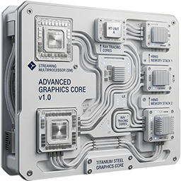 | `windows-portable/icons/windows-portable-<size>.png` (1024, 512, 256 and 128 px) | The icon of the Windows Portable Suite, the owner's drawing (26-10-2026): the set its portal's and wiki's copies are made from. |
| 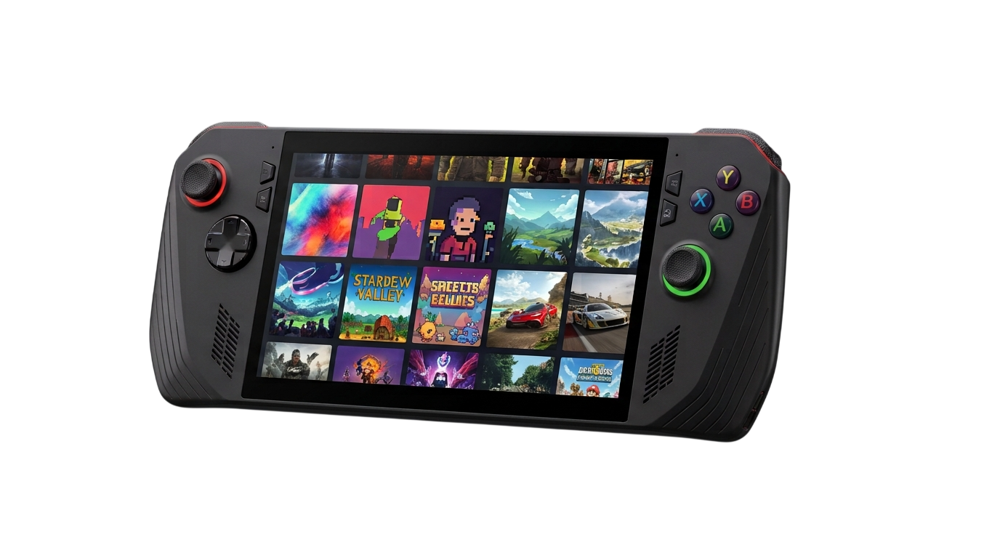 | `windows-portable/icons/windows-portable-device.png` (1376 x 768) | The handheld, the owner's picture (26-10-2026): the hero of the suite's wiki home, as the board is the BC250 wiki's. |
| 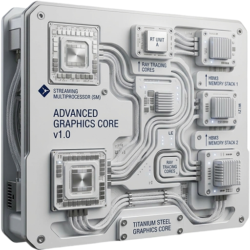 | `windows-portable/apps/test/images/windows-portable-test.webp` (512 px), `-128.png` | Windows Portable Test, the suite's test app: the suite's icon (the test app is the suite's base, as BC-250 Bazzite Test is the BC250 suite's), its window header and window icon, and its Start-menu shortcut. Lossless copies of the drawing, written by this tool. |

## Nexus

### The Nexus icon

| Icon | File | Used for |
| --- | --- | --- |
| 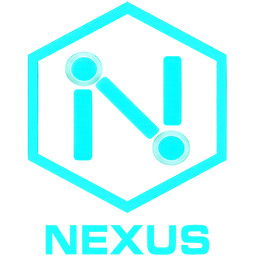 | `nexus/images/nexus-<size>.png` (1024, 512, 256 and 128 px) | The icon of Nexus, the owner's drawing (25-10-2026): the set the copies are made from. |
| 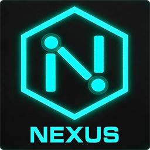 | `nexus/docs/images/nexus.webp`, `.png` (256 px) | The Nexus page's header logo and its home page's footer (`.webp`), and its favicon (`.png`): the 256 px drawing, transparent (owner, 27-10-2026: no more dark tile), both written by this tool. |
| 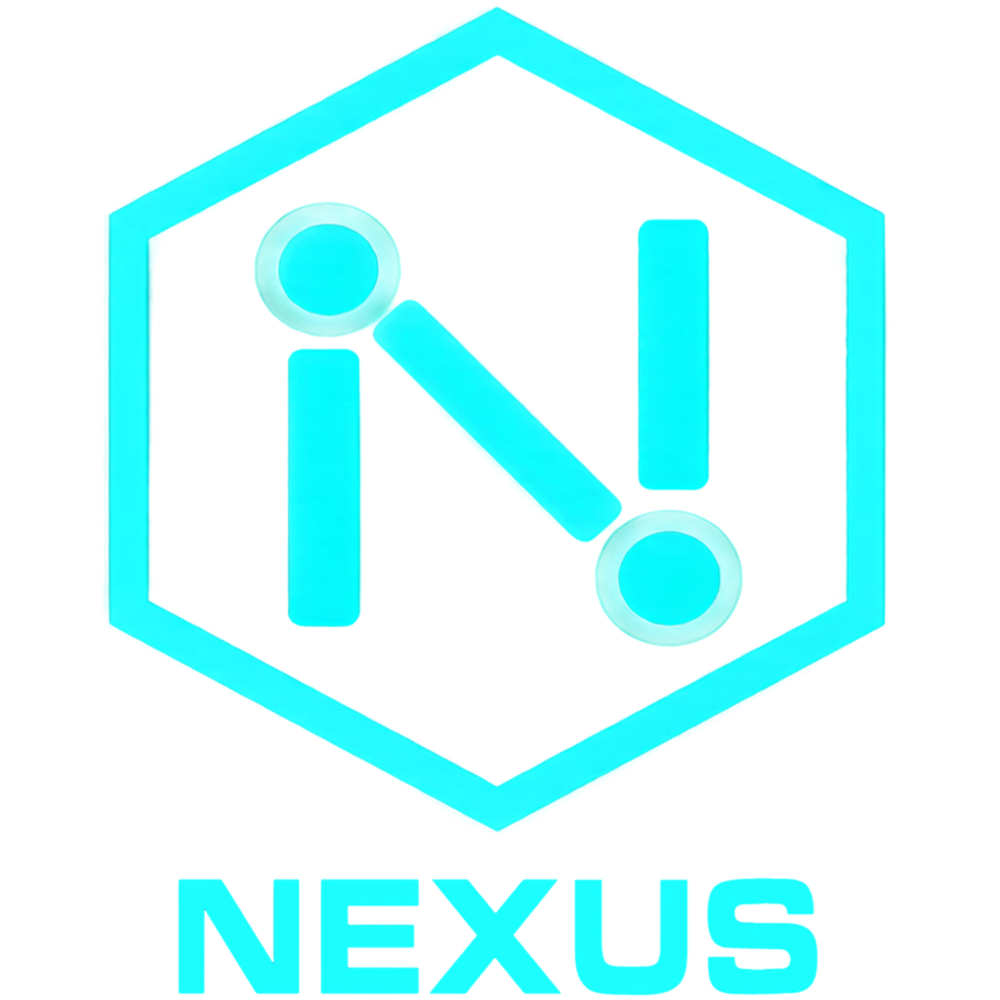 | `nexus/docs/images/nexus-hero.webp` (1024 px) | The Nexus page's home: the icon under the headline, a WebP copy of the 1024 px drawing. |
| 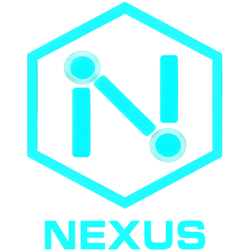 | `dev/releases/images/nexus-releases.webp` (512 px), `-128.png` | Nexus Releases, Nexus's app (owner, 26-10-2026: it takes Nexus's icon, not a category's): its window header and window icon, its menu entry and Desktop icon. Lossless copies of the drawing, written by this tool. |

### Material Design icons on the Nexus page

Drawn by MkDocs Material in the page's colors.

| Icon | Name | Used for |
| --- | --- | --- |
|  | `material-file-tree` | Home: the card "Nexus". |
|  | `material-view-grid` | Home: the card "A suite". |
|  | `material-application` | Home: the card "An app". |
|  | `material-chip` | Home: the card "BC250 Bazzite Suite". |
