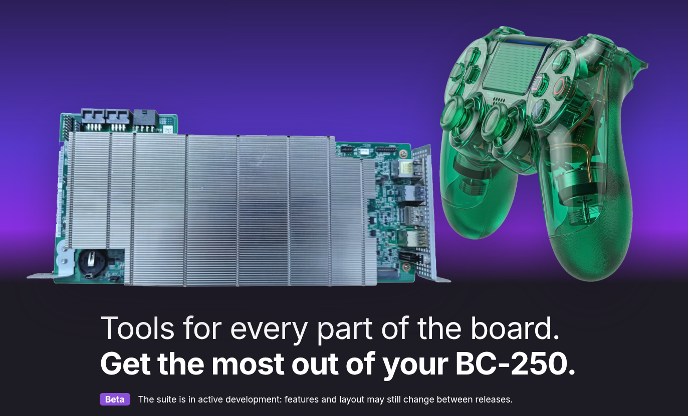
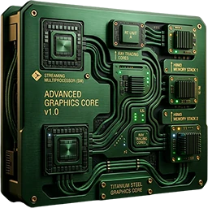
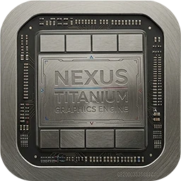
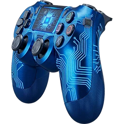
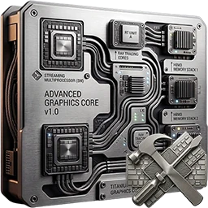
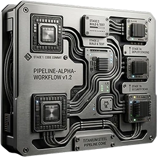

<!-- SPDX-License-Identifier: GPL-3.0-or-later -->

[](https://github.com/RobertoTorino/nexus/actions/workflows/ci.yml)

[](LICENSE)

# Nexus

One home for the suites: one repository holding every suite, the code they share, and the tools that test and
release them. A suite is the apps for one operating system on one kind of device; its portal installs, opens, updates
and removes them, and each suite has its own wiki. The name, the structure and how the suites relate:
**[the Nexus page](https://robertotorino.github.io/nexus/)**.

## The suites

- **[BC250 Bazzite Suite](#bc250-bazzite-suite)**: tools for the AMD BC-250 running Bazzite, at the root of this
  repository. [Its wiki](https://robertotorino.github.io/nexus/bc250-bazzite-suite/).

## BC250 Bazzite Suite

Tools for the AMD BC-250 running Bazzite. The **[portal](portal)** installs, opens, updates
and removes them: BC-250 Bazzite Test is always installed, every other app is optional.

**Beta:** The suite is in active development: features and layout may still change between releases.



### Install

**Install the portal, not the apps one by one.** It installs, updates and removes every app below for you, and
checks each download against its checksum.

1. Open the **[latest portal release](https://github.com/RobertoTorino/nexus/releases/latest)** and
   download `portal-v<version>.tar.gz` and `SHA256SUMS`.
2. In a terminal, in the folder you downloaded them to:

   ```bash
   sha256sum --check --ignore-missing SHA256SUMS
   tar -xzf portal-v*.tar.gz && cd portal-v*/ && ./install.sh
   ```

3. Start **BC250 Bazzite Suite** from the app menu or the Desktop, and install the apps you want from there.

The other releases on the Releases page (`gpu-v…`, `upscaler-v…` and so on) are the app downloads the portal
uses. You do not need them.

### The apps

By category, as the portal's tabs list them.

**Sustainable**: the board itself: test it, tune it, unlock it, cool it, and keep it running well.

-  **[BC-250 Bazzite Test](bc250-bazzite/apps/check)**: Read-only diagnostics, stress test and benchmarks. Always installed.
-  **[BC-250 GPU Governor Manager](bc250-bazzite/apps/gpu)**: Manage the cyan-skillfish GPU governor: tuning, safe points, profiles, backups.
-  **[BC-250 CU Bisect](bc250-bazzite/apps/compute)**: Tell bad CUs apart from an unstable CU unlock, and apply a tested unlock.
-  **[BC-250 Cores Bisect](bc250-bazzite/apps/cores)**: Tell bad CPU cores apart from an unstable core unlock, before you persist the 8C/16T unlock.
-  **[BC-250 GPU OC Bisect](bc250-bazzite/apps/oc)**: Find your board's safe GPU overclock and undervolt, one step at a time.
-  **[BC-250 Persistent ACPI](bc250-bazzite/apps/acpi)**: CPU C-states and frequency scaling through a persistent ACPI override (GRUB early initrd).
-  **[BC-250 Memory Manager](bc250-bazzite/apps/vram)**: The VRAM split in CMOS, with the GTT, TTM limit and swap layout that go with it.
-  **[BC-250 Fan Control](bc250-bazzite/apps/fan)**: A thermal guard that warns, cools and shuts down cleanly at a critical temperature, and the fans.

**Graphics**: graphics features for games.

-  **[BC-250 Upscaler Manager](bc250-bazzite/apps/upscaler)**: Deploy HelixSR (FSR 3.1 drop-in upscaler with DLSS-style networks) into games.
-  **[BC-250 ACE Queues](bc250-bazzite/apps/ace)**: Async compute for games: a patched RADV beside the system Mesa, built on the board and tested before use.
-  **[BC-250 Mesh Shaders](bc250-bazzite/apps/mesh)**: Mesh shaders for games: RADV with DirectMesh beside the system Mesa, built on the board and tested before use.

**Gaming**: apps for playing.

-  **[Console Link](bc250-bazzite/apps/consoles)**: Find, wake and register PS4 and PS5 consoles on the network, and start a Remote Play session.
-  **[Console LinkB](bc250-bazzite/apps/clb)**: Stream your Xbox (Remote Play) or games from Xbox Cloud Gaming to the board, signed in with your Microsoft account.
-  **[shadPS4 Manager](bc250-bazzite/apps/shadps4)**: PS4 games with the shadPS4 emulator: a tested shadPS4 release, your games found (or unpacked from .pkg files) and added to Game Mode.
-  **[Decky Loader Manager](bc250-bazzite/apps/decky)**: Plugins in Game Mode with Decky Loader: a tested Decky release as a system service, its state and its plugins.
-  **[RPCS3 Manager](bc250-bazzite/apps/rpcs3)**: PS3 games with the RPCS3 emulator: a tested RPCS3 build, the firmware, your games found and added to Game Mode.
-  **[Bazzite DatStation](bc250-bazzite/apps/datstation)**: PlayStation quiz, console history, system versions, region codes, user guides and news, with your scores.
-  **[PPSSPP Manager](bc250-bazzite/apps/ppsspp)**: PSP games with the PPSSPP emulator: a tested PPSSPP release, your games found and added to Game Mode.
-  **[PCSX2 Manager](bc250-bazzite/apps/pcsx2)**: PS2 games with the PCSX2 emulator: a tested PCSX2 release, your PS2 BIOS, your games found and added to Game Mode.
-  **[Vita3K Manager](bc250-bazzite/apps/vita3k)**: PS Vita games with the Vita3K emulator: a tested Vita3K build, the firmware and your games installed through it, added to Game Mode.
-  **[Xenia Manager](bc250-bazzite/apps/xenia)**: Xbox 360 games with the Xenia emulator (experimental on Linux): a tested Xenia build, your games found and added to Game Mode.

**Utilities**: handy tools around the board.

-  **[System Overlay](bc250-bazzite/apps/overlay)**: CPU, GPU, refresh rate, fan and temperatures in a small window that stays on top.
-  **[USB IPS3.5](bc250-bazzite/apps/ips35)**: CPU, GPU, memory, fan and temperatures on a Turzx USB IPS screen (Turing Smart Screen 3.5"), with the time, the date and the weather, in your own theme and colors.
-  **[USB HD Cam](bc250-bazzite/apps/hdcam)**: the PS5 HD Camera (CFI-ZEY1) as a webcam: loads its firmware at every plug-in and shows its picture, one camera or both side by side.
-  **[USB HD Control](bc250-bazzite/apps/hdcontrol)**: the DualSense and DualSense Edge: battery, firmware updates from the official server over USB, and the Edge's profiles with a backup.
-  **[BC-250 BIOS Reader](bc250-bazzite/apps/bios)**: The BIOS settings as the setup screen shows them, hidden menus included. Stock or modded BIOS. Read-only.
-  **[BC-250 USB Wi-Fi](bc250-bazzite/apps/wdriver)**: The driver for AIC8800D80 USB Wi-Fi sticks: built for the running kernel, loaded at boot, rebuilt after a kernel update.
-  **[HDMI CEC Manager](bc250-bazzite/apps/cec)**: Turn the TV on and off with the board, switch its input and use its remote, over HDMI-CEC.
-  **[Bazzite SFTP Tools](bc250-bazzite/apps/sftp)**: Move files between computers over SFTP, and manage the SSH server of a Bazzite host.

**Development**: tools for working on the suite. You do not need them to use the board.

-  **[Media Tool](bc250-bazzite/apps/mtool)**: Record a BC250 Bazzite Suite installation demo with OBS, and convert the suite's icons.
-  **[Dependency Checker](bc250-bazzite/apps/package)**: The suite's Python packages and external tools, which apps use them, and whether newer ones exist; and whether a Bazzite update waits for a reboot.
-  **[Bazzite NetcatGUI](bc250-bazzite/apps/ncgui)**: A graphical netcat: connect to a host or listen on a port, TCP, UDP or TLS, one session per tab.
-  **[BC250 Suite Releases](bc250-bazzite/apps/suite)**: The release front end: versions, pins and the board checks of a release. Runs from a checkout of this repository.
-  **[BC-250 Installer Tests](bc250-bazzite/tools/installer-tests/gui)**: Run the suite's installer tests one at a time, with their output live in the window. Runs from a checkout of this repository.

How to install and use them: **[the manual](https://robertotorino.github.io/nexus/bc250-bazzite-suite/)**.

## License

For every suite: GPL-3.0-or-later ([LICENSE](LICENSE)), except BC-250 Persistent ACPI, which is MIT, Console Link, which is
AGPL-3.0 (its protocol code comes from chiaki-ng), and Bazzite NetcatGUI, which is GPL-2.0 (a port of NetcatGUI).
Each app keeps its own `LICENSE`. The icons were made with generative AI tools and edited by hand in Photoshop, the
sounds and the music of the video tours with generative AI tools; all are under the license of the folder they are in,
like the code beside them.

## Disclaimer

The BC250 Bazzite Suite is an independent community project. It is not affiliated with or endorsed by AMD, ASRock,
the Bazzite / Universal Blue project, Sony, Microsoft, Nintendo, Valve, or the makers of the emulators and the other
programs the apps work with. BC-250 is AMD's product name and Bazzite the Universal Blue project's. PlayStation, PS4,
PS5, PS3, PS2, PSP, PS Vita, DualSense and Remote Play are Sony's; Xbox, Xbox 360, Xbox Cloud Gaming and Windows are
Microsoft's; Steam, Steam Deck and Big Picture are Valve's; the names of Nintendo's consoles, of the emulators
(shadPS4, RPCS3, PPSSPP, PCSX2, Vita3K, Xenia) and of Decky Loader, HelixSR and DirectMesh belong to their owners.
The suite uses them only to say what it works with.
