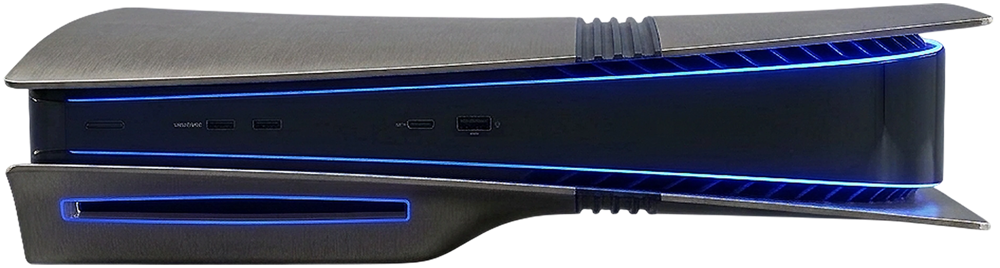

<!-- SPDX-License-Identifier: GPL-3.0-or-later -->

<section class="home-hero" markdown>

{ .home-hero__board }
{ .home-hero__controller }

# Bazzite Console Suite { .home-hero__lead }

Control your PlayStation 5 running Bazzite.

</section>

<section class="home-section home-section--dark" markdown>

## The app

**Bazzite Test** is the suite's required first app. It presents read-only system details for the PlayStation 5
running Bazzite.

[All apps](apps/index.md){ .md-button }
[About the portal](portal.md){ .md-button }

</section>

<section class="home-section home-section--accent" markdown>

## Get started

The portal installs Bazzite Test and lists the suite's apps. See [Install](install.md) for the installation steps.

</section>
