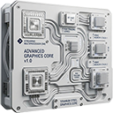
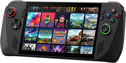

<!-- SPDX-License-Identifier: GPL-3.0-or-later -->


[](https://github.com/RobertoTorino/nexus/actions/workflows/ci-windows-portable.yml)
[](../LICENSE)

# Windows Portable Suite

Tools for Windows 10/11 on portable gaming devices, first the ASUS ROG Xbox Ally X, a suite of
[Nexus](../README.md). The apps are made for the device in your hands: full screen, a small screen, a controller and
touch. The **[portal](portal)** installs, opens, updates and removes them: Windows Portable Test is always installed,
every other app is optional.

## Install

**Install the portal, not the apps one by one.** It installs, updates and removes every app below for you, and
checks each download against its checksum.

1. Open the **[Nexus index](https://github.com/RobertoTorino/nexus/releases/latest)**, GitHub's latest release,
   and under **Windows Portable Suite** download `wp-portal-v<version>.zip` and `SHA256SUMS`.
2. In PowerShell, in the folder you downloaded them to:

   ```powershell
   (Get-FileHash wp-portal-v<version>.zip).Hash -eq (-split (Get-Content SHA256SUMS))[0]   # True: the download is intact
   Expand-Archive wp-portal-v<version>.zip . -Force
   powershell -ExecutionPolicy Bypass -File wp-portal-v<version>\install.ps1
   ```

3. Start **Windows Portable Suite** from the Start menu or the Desktop, and install the apps you want from there.

Everything installs for your own user, not as administrator. The programs are not signed, so Windows may ask once
whether to run them. The other releases with `wp-` tags (`wp-test-v…` and so on) are the app downloads the portal
uses. You do not need them.

## The apps

By category, as the portal's tabs list them.

**Sustainable**: the handheld itself.

-  **[Windows Portable Test](apps/test)**: What Windows reports about the handheld, its network, and a test of every button, stick and trigger of its controller. Always installed.

**Gaming**: games and their emulators on the handheld.

-  **[PCSX2 Manager](apps/pcsx2)**: Installs PCSX2, the PlayStation 2 emulator, in portable mode, and opens it.
-  **[PPSSPP Manager](apps/ppsspp)**: Installs PPSSPP, the PSP emulator, in portable mode, and plays your PSP games.
-  **[RPCS3 Manager](apps/rpcs3)**: Installs RPCS3, the PS3 emulator, takes the PS3's firmware and your packages, and plays your PS3 games.
-  **[shadPS4 Manager](apps/shadps4)**: Installs shadPS4, the PS4 emulator, takes the system modules, unpacks your packages, and plays your PS4 games.

How to install and use them: **[the wiki](https://robertotorino.github.io/nexus/windows-portable-suite/)**.

## License

GPL-3.0-or-later ([LICENSE](../LICENSE)). Each app keeps its own `LICENSE`. The icons and pictures were made with
generative AI tools and edited by hand, the sounds with generative AI tools; all are under the license of the folder
they are in, like the code beside them.

## Disclaimer

Nexus and its suites are independent community projects, not affiliated with or endorsed by AMD, ASRock, the Bazzite
/ Universal Blue project, Sony, Microsoft, Nintendo, Valve, or the makers of the emulators and the other programs the
apps work with. BC-250 is AMD's product name and Bazzite the Universal Blue project's. PlayStation, PS4, PS5, PS3,
PS2, PSP, PS Vita, PSN, DualSense and Remote Play are Sony's; Xbox, Xbox 360, Xbox Cloud Gaming, Game Pass and
Windows are Microsoft's; Steam, Steam Deck and Big Picture are Valve's; the names of Nintendo's consoles, of the
emulators (shadPS4, RPCS3, PPSSPP, PCSX2, Vita3K, Xenia) and of Decky Loader, HelixSR and DirectMesh belong to their
owners. The suites use them only to say what their apps work with.
