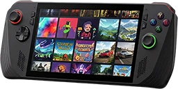

<!-- SPDX-License-Identifier: GPL-3.0-or-later -->

{ .app-logo }

# DatStation

PlayStation knowledge on your handheld: a quiz against the clock, the consoles' history, system software versions, region codes, user guides and PS news.

DatStation is the PlayStation knowledge part of the [DatStation](https://github.com/RobertoTorino/DatStation)
Android app, the same as the BC250 Bazzite Suite's Bazzite DatStation, made for the handheld in your hands. It keeps
your quiz scores and trophies on the handheld.

DatStation is on the [portal](../portal.md)'s **Gaming** tab: **A** on its tile installs it, and once it
is installed, **A** opens it. It is also in the Start menu (**Windows Portable Suite**, **DatStation**). It opens full
screen; **B** goes back and **⧉** (View) exits it.

## The front page

Seven tiles, one per feature, each with a controller shape: **PlayStation Quiz**, **PlayStation History**, **System
Versions**, **Region Codes**, **User Guides**, **PS News** and **Scores & Trophies**. The d-pad moves between them;
the pane under the tiles says what the one with the focus opens. **A** opens it, a tap on a tile gives it the focus
and a second tap opens it. **B** on a page comes back to its tile. **☰** (Menu) opens the information of the page
that shows.

| Button | On the front page |
|---|---|
| **A** | Open the tile's page (User Guides: open Sony's manuals in your browser) |
| **Y** | Add to Steam, or Update in Steam once it is there |
| **X** | Take out of Steam (press it twice within five seconds) |
| **☰** | About the app |
| **⧉** | Exit |

### In Steam

**Y** adds DatStation to Steam's library as a non-Steam game, for every Steam user on the handheld, with artwork
drawn from the app's icon, so you can start it from Steam and its full-screen mode too. Steam closes while its
shortcut file changes and starts again afterwards. Once it is there, **Y** brings the entry up to date and **X**
takes it out again, artwork included, on a second press. The other non-Steam games stay as they are. Without Steam
on the handheld, the pane says so and the buttons are not in the legend.

## PlayStation Quiz

Pick a category with the d-pad and **A**: the **Quick Quiz** (6 questions from all of them, nothing saved), or
ALL, TRUE/FALSE, PS1 to PS5, PSVITA, PSP, CONTROLLER, GENERAL, DIALOGUE or APPS. The line at the bottom says how many
questions the category with the focus has.

A round starts with 42 seconds on the clock. A right answer adds 5 seconds and the question's points; a wrong
answer or a skip takes 5 seconds. The clock stops while an answer is shown and while the game is paused. The right
answer turns green, a wrong choice red, and for a wrong answer the right one is named, with an explanation where
the question has one. A question is not asked twice in one game until the category's questions are used up.

| Button | In a round |
|---|---|
| **d-pad** | Move between the answers |
| **A** (or a tap) | Answer |
| **X** | Skip the question (5 seconds off) |
| **Y** | Pause; again to resume |
| **LB** | Music on or off (the choice is kept) |
| **B** | Leave the round: press it twice within five seconds, the round is lost |

With a keyboard, the keys **1** to **4** answer too.

The round ends when all its questions are answered, or when the clock runs out. The results show the right and
wrong answers, the time left, the total score with the share of right answers and, for a complete round, a review
with a bronze (50 % and more), silver (75 %) or gold (95 %) star. A round with every answer right is a **Perfect
round**: **A** (Next round) then asks five questions more, with the score and the clock kept. Otherwise **A**
(Retry) starts the category again from zero. **B** goes back to the categories.

Every finished round of a saved game adds a score to Scores & Trophies; a perfect round adds a Perfect trophy. The
quick quiz adds nothing. The music plays while a round is on.

## PlayStation History

Every console since 1994 in a list: the PlayStation, PlayStation 2, Sony PSX, PlayStation Portable, PlayStation 3,
PlayStation Vita, PlayStation 4, PlayStation 5 and the PlayStation Portal. Beside the list, the one with the focus:
what it sold, how many titles it had, and a brief overview of its legacy. **A** opens pictures of it on the web, in
your browser.

## System Versions

The systems in a list, from the PlayStation 6 (a placeholder until there is one) to the PlayStation 1. Beside it,
every system software release of the one with the focus: its version, release date and notes and, where the data has
them, its region, model, color, size and hardware facts. **A** (or right) goes into the versions, where up and down
on the d-pad scroll them, and a finger drags them; **B** goes back to the list.

## Region Codes

Per PlayStation, what the prefix of a title ID says about the market and the publisher (PPSA, ELJM, BCES, SLUS,
...), in a table, and for the PS1 and PS2 what the last digit of the model number says about the region. The list and
the text work as on System Versions.

## User Guides

The tile opens Sony's online manuals for every PlayStation product (`manuals.playstation.net`) in your browser.

## PS News

The latest announcements from the PlayStation.Blog feed, newest first. The page loads the feed when you open it,
never before; it needs a network connection. The line under the list says when the one with the focus was posted.

| Button | On PS News |
|---|---|
| **A** | Open the post in your browser |
| **X** | PlayStation's Upcoming Games page |
| **RB** | New Releases in the PlayStation Store |
| **Y** | Load the feed again |

Only links to PlayStation's own sites (`playstation.com`, `blog.playstation.com`, `store.playstation.com`) are
opened; anything else in the feed is blocked, and the line at the bottom says so.

## Scores & Trophies

Your best score, the top ten rounds with their category, round and time, and the trophies, newest first. **X**
clears every score and trophy: press it twice within five seconds. It cannot be undone.

## Install it on its own

The portal installs it. To install it on its own, download `wp-datstat-v<x.y.z>.zip` and `SHA256SUMS` from its release,
then in PowerShell, in that folder:

```powershell
(Get-FileHash wp-datstat-v<x.y.z>.zip).Hash -eq (-split (Get-Content SHA256SUMS))[0]   # True: the download is intact
Expand-Archive wp-datstat-v<x.y.z>.zip . -Force
powershell -ExecutionPolicy Bypass -File wp-datstat-v<x.y.z>\install.ps1
```

Installed on its own, it gets a Start-menu entry and a Desktop shortcut. Afterwards the installer asks whether to
remove the download.

| Option | |
|---|---|
| `--no-desktop-shortcut` | the Start-menu entry only |
| `--uninstall` | remove the app; the settings, the scores and the log stay |
| `--uninstall --purge` | also remove the settings, the scores and the log |

## Files

| Where | What |
|---|---|
| `%LOCALAPPDATA%\windows-portable-suite\windows-portable-datstat\app\` | The program, `DatStation.exe` |
| `%LOCALAPPDATA%\windows-portable-suite\windows-portable-datstat\scores.json` | The quiz scores and trophies |
| `%LOCALAPPDATA%\windows-portable-suite\windows-portable-datstat\windows-portable-datstat.log` | The log |
| `%APPDATA%\windows-portable-suite\windows-portable-datstat.ini` | The settings (the music on or off) |
| Steam's `userdata\<user>\config\shortcuts.vdf` and `grid\` | The non-Steam game and its artwork, only after **Y**, and gone again after **X** |

## Privacy

The app collects no personal data and sends none: no accounts, no analytics, no crash reporting. The only network
requests it makes are the ones you ask for: loading the PlayStation.Blog feed when you open PS News (a plain HTTPS
request to `blog.playstation.com`, identified as `windows-portable-datstat/<version>`), and opening a PlayStation
page or a picture search in your browser. Your scores and settings stay in the files above.

## When something does not work

- **"Could not load announcements":** the handheld has no network, or the feed did not answer. The line at the
  bottom says why; **Y** tries again.
- **"Blocked unexpected link":** a post in the feed points outside PlayStation's sites, which the app does not open.
- **No music:** the music needs an audio output. Check that the legend shows **LB Music off** (the music is on); the
  quiz plays the same without it.
- **"Steam was not changed: Steam did not close":** Steam was asked to close for the change and did not within 30
  seconds; nothing was changed. Close Steam yourself and press **Y** again.
- **"Steam has no users on this system yet":** sign in to Steam once, then press **Y** again.
