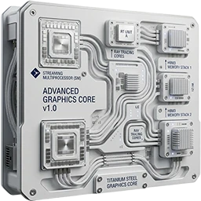

<!-- SPDX-License-Identifier: GPL-3.0-or-later -->

{ .app-logo }

# Windows Portable Test

Gets to know a **Windows portable device**: what Windows reports about the device, how its network does, and every
button, stick and trigger of its controller as you press them. It reads and shows; it changes nothing on the device.

Windows Portable Test is always installed with the [portal](../portal.md) and is its first tile. Open it there with
**A**, or from the Start menu (**Windows Portable Suite**, **Windows Portable Test**). It opens full screen.

## The screen

Five cards on the left: Device, Hardware, Connected, Network and Controller; the right side shows what the focused
card does. The d-pad or the left stick moves the amber focus between the cards, **A** runs the focused card, **B**
goes back from a pane to its card (on a card it does nothing), **⧉** (View) exits the app and **☰** (Menu) opens the
information of the pane that shows. Every action is a button, listed in the row at the bottom with what it does on the
pane that shows (**A Read**, **X Save report**, **☰ Info**, **⧉ Exit**): press the button, or
tap the entry. Every card and entry also works by touch. The amber edge shows where you are: on a card with a glow
under it, and on the pane at the right, with its card keeping only the edge, once the focus moves into it. The top
right shows the date and the time, `Wednesday 28/10/2026 | 17:04`, and under them, live every five seconds, the CPU's
and the GPU's temperature, the power the chip draws, the refresh rate of the screen and the battery: `CPU 47° GPU 45°
| 18 W | 120 Hz | 82%`. On a device with AMD graphics the temperatures and the power come from AMD's driver; on
another the GPU's temperature comes from Windows (as Task Manager shows it), and the CPU's and the power are left out.
The refresh rate is the screen the window is on: docked to a TV, it is the TV's.

The wallpaper the portal shows is behind its cards too, unless it is switched off on the portal's Settings page.

The information icon (a ring with an i) at the top right of a pane opens more about it, over the window, and so
does **☰**; **A**, **B** or **☰** closes it. With the focus on it, its ring is amber.

## Device

What Windows reports about the device: its name, the processor with its cores and threads, the graphics
and its driver, the memory (installed and usable), the storage, the screen the window is on (its pixels, Windows'
scaling and the refresh rate), Windows' version, the firmware and the battery. No serial numbers.

Nothing is read until you ask: press **A** on the Device, Hardware or Connected card, or tap **A Read** in the row
at the bottom. One read fills all three; Windows takes about five seconds to answer. **A Read again** reads it once
more.

**X** saves what the three cards show as one text report in
`%LOCALAPPDATA%\windows-portable-suite\windows-portable-test\reports\` (`device-<date>-<time>.txt`), a section per
card, with the Network card's last when it was measured; the card says where.

## Hardware

What is built in: the panel's size (Windows gives it in whole centimeters, so the inches are rounded), the touch
screen and how many touch points it takes, the built-in controller, the Wi-Fi adapter with its driver, the Bluetooth
adapter, audio, the fingerprint reader, a camera, the sensors (such as the accelerometer) and the USB controllers
(USB4 shows here). Of Bluetooth only the adapter is listed, never a paired device, and no MAC address is read.

**Problems** lists the built-in devices that Device Manager marks with a yellow sign, with what is wrong: no driver,
disabled, cannot start. Without such a device the row is left out.

## Connected

What is plugged in, as Windows keeps it apart from what is built in. With nothing plugged in, the card says so.

| Row | What it shows |
|---|---|
| Dock or hub | The dock's or hub's chip and its speeds, such as **Realtek hub chip (USB 3, USB 2)** |
| Devices | Every other USB device: a camera, a USB screen, a controller, a keyboard. **via the hub** means it is plugged into the dock or hub, not into the device itself; Device Manager's problem shows beside it, such as **no driver** |
| Screens | The screens beside the built-in one, with how they are connected, such as DisplayPort or HDMI |
| Network | Network adapters on USB, with their state (**connected, 1 Gbps** or **no cable**) and whether they are on the dock |
| Drives | Drives on USB |

A dock tells Windows only who made the chip inside it, never its own brand: a JSAUX dock, for one, shows as a Realtek hub chip.
Network adapters show by their chip too: a Ugreen adapter is an **ASIX AX88179**, many docks carry a **Realtek USB
GbE** chip. Such a chip shows even when the dock has no Ethernet port of its own; with no cable in it, it says **no
cable**. Adapters that were plugged in once but are not now are never listed (Device Manager shows them only under
View, Show hidden devices).

Windows Portable Suite's own devices are named: the PS5 HD Camera (**PlayStation camera without its firmware** until
USB HD Cam loads it; Windows has no driver for it until then) and the Turzx USB screen that Smart Screen drives.

A screen on a dock's or a stand's HDMI port shows as **DisplayPort**: the device sends the picture as DisplayPort
over USB-C, and the dock turns it into HDMI.

## Network

How the network does at this moment, to compare a slow moment with a fast one, on mains and on battery, and Wi-Fi
with a cable. **A** on the Network card, or **A Test** in the row at the bottom, measures it; it takes about fifteen
seconds, and ten more for each further connected adapter. **A Test again** measures once more.

| Row | What it shows |
|---|---|
| Wi-Fi | The band (2.4, 5 or 6 GHz) and the channel |
| Standard | Wi-Fi 6 (802.11ax), Wi-Fi 5 (802.11ac) and so on |
| Signal | The signal in percent and in dBm |
| Rate | The link's rate down and up, in Mbps: what the adapter and the access point agreed, not the download speed |
| Wired | The Ethernet adapter that is connected (on USB or a dock) and its link speed, such as 1 Gbps |
| Power | Mains or battery, and the power plan |
| Wi-Fi on mains, Wi-Fi on battery | The power plan's Wi-Fi setting: Maximum Performance to Maximum Power Saving |
| Other traffic | What the device received in the two seconds before the download |
| Also running | Delivery Optimization's downloads (Windows Update, the Microsoft Store and the Xbox app's games) and the programs that download on their own: Steam, the Xbox app, the Epic Games Launcher, Windows Update and others |
| Download, wired; Download, Wi-Fi | The speed of a timed download over each connected adapter in turn: Windows Portable Test's newest release from GitHub, as the portal downloads it, for ten seconds at most each. Nothing is kept |

A slow download with a good link (a high rate and signal) points past the device: the access point, the internet
connection or GitHub at that moment. With a cable and Wi-Fi both connected, each gets a download of its own, so the
two can be compared; without Wi-Fi the card says so and times the wired download. The network's name, the access
point's address and the device's IP addresses are never shown.

**X** saves the measurement in the same report as the device, as its Network section.

## Controller

**A** on the Controller card starts the test. Every button lights amber while you hold it and keeps an amber label
once it answered, so a button that never answers stands out; the count under them says how many answered. The sticks
show as a dot in a circle with their position, the triggers as a bar from 0 to 100 %.

During the test every button is the test's, B too: **hold B** for a second and a half, or tap **B Hold to finish**
in the row at the bottom, to end it.
On a keyboard, Escape ends it.

The buttons on the card are those Windows reports for an Xbox controller: LB, View, Xbox, ☰ (Menu), RB, the d-pad,
A, B, X, Y and the two stick presses, and on an ASUS device such as the ROG Xbox Ally X the **back buttons M1 and
M2** as one chip, **M1/M2**. They are Armoury Crate's own modifiers (held with A a screenshot, with Y a recording),
never gamepad buttons, and Armoury Crate reports either of them the same way, so Windows cannot tell M1 from M2: the
chip lights for both. To use them as two buttons, map them in Armoury Crate (Settings, Configure, M1 or M2: untick
Secondary Function and choose a button); they then light that button. A device without ASUS's channel shows no
M1/M2 chip, and the count leaves it out. The information icon at the top right of the Controller card's pane says so
on the device; it is there before and after the test, not during it.

The **Command Center** button comes through the same ASUS channel, and only when you let it go: a short press
lights **Command** (it opens Command Center), a long press lights **Armoury** (it opens Armoury Crate). Each chip
lights for a moment and then keeps its amber label. Like M1/M2, they show only on a device with ASUS's channel.

The **Xbox** button lights **Xbox**. While Steam runs, it also opens Steam over the test: Steam's setting
**Guide Button Focuses Steam** (Steam's Settings, Controller) takes it. Turn that off to keep the test in front.

## Stick lights

The stick lights are tested with the buttons: while the controller test runs, **A**, **B**, **X** and **Y** light
both sticks in their color (green, red, blue and yellow), and a stick moved or pressed lights its own ring white with
the other dark. The line under the count says what Windows reports, the controller and its lamps (four on the ROG
Xbox Ally X, two around each stick), and what is lit now.

The app sets the lights through Windows' Dynamic Lighting, and Windows lets it do so only while its window is in
front; the end of the test gives them back to the app that sets them otherwise, such as Armoury Crate. When the line
says there are none, switch Dynamic Lighting on in Settings > Personalization > Dynamic Lighting, with the controller
listed and on there, and start the test again; when it says another window is in front, close that one (Armoury
Crate's or Steam's overlay) first.

## Install it on its own

The portal installs it. To install it on its own, download `wp-test-v<x.y.z>.zip` and `SHA256SUMS` from its
release, then in PowerShell, in that folder:

```powershell
(Get-FileHash wp-test-v<x.y.z>.zip).Hash -eq (-split (Get-Content SHA256SUMS))[0]   # True: the download is intact
Expand-Archive wp-test-v<x.y.z>.zip . -Force
powershell -ExecutionPolicy Bypass -File wp-test-v<x.y.z>\install.ps1
```

Installed on its own, it gets a Start-menu entry and a Desktop shortcut. Afterwards the installer asks whether to
remove the download.

| Option | |
|---|---|
| `--no-desktop-shortcut` | the Start-menu entry only |
| `--uninstall` | remove the app; the settings, the log and the reports stay |
| `--uninstall --purge` | also remove the settings, the log and the reports |

## Files

| Where | What |
|---|---|
| `%LOCALAPPDATA%\windows-portable-suite\windows-portable-test\app\` | The program, `Windows-Portable-Test.exe` |
| `%LOCALAPPDATA%\windows-portable-suite\windows-portable-test\reports\` | The saved reports |
| `%LOCALAPPDATA%\windows-portable-suite\windows-portable-test\windows-portable-test.log` | The log |
| `%APPDATA%\windows-portable-suite\windows-portable-test.ini` | The settings |
