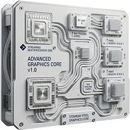

<!-- SPDX-License-Identifier: GPL-3.0-or-later -->

{ .app-logo }

# Windows Portable Test

Gets to know a **Windows handheld**: what Windows reports about the device, and every button, stick and trigger of
its controller as you press them. It reads and shows; it changes nothing on the device.

Windows Portable Test is always installed with the [portal](../portal.md) and is its first tile. Open it there with
**A**, or from the Start menu (**Windows Portable Suite**, **Windows Portable Test**). It opens full screen.

## The screen

Four cards on the left: Device, Hardware, Connected and Controller; the right side shows what the focused card does.
The d-pad or the left stick moves the amber focus between the cards, **A** runs the focused card, **B** closes the
app. Every card and pill also works by touch. The line at the top shows the battery, the date and the time.

## Device

What Windows reports about the handheld: the device's name, the processor with its cores and threads, the graphics
and its driver, the memory (installed and usable), the storage, the screen the window is on (its pixels, Windows'
scaling and the refresh rate), Windows' version, the firmware and the battery. No serial numbers.

Nothing is read until you ask: press **A** on the Device, Hardware or Connected card, or tap **Read**. One read
fills all three; Windows takes about four seconds to answer. **Read again** reads it once more.

**X** saves what the three cards show as one text report in
`%LOCALAPPDATA%\windows-portable-suite\windows-portable-test\reports\` (`device-<date>-<time>.txt`), a section per
card; the card says where.

## Hardware

What is built in: the panel's size (Windows gives it in whole centimeters, so the inches are rounded), the touch
screen and how many touch points it takes, the Wi-Fi adapter with its driver, the Bluetooth adapter, audio, the
fingerprint reader, a camera, the sensors (such as the accelerometer) and the USB controllers (USB4 shows here). Of
Bluetooth only the adapter is listed, never a paired device, and no MAC address is read.

## Connected

What is plugged in: a dock or a hub, the screens beside the built-in one (with how they are connected, such as
DisplayPort or HDMI), network adapters on USB (a dock's Ethernet port) and drives on USB. Windows does not tell a dock
from a hub: a dock is a USB hub with ports behind it, so the card shows the hub's maker (such as Realtek, USB 3 and
USB 2) and what is behind it. With nothing plugged in, the card says so.

A screen on a dock's or a stand's HDMI port shows as **DisplayPort**: the handheld sends the picture as DisplayPort
over USB-C, and the dock turns it into HDMI.

## Controller

**A** on the Controller card starts the test. Every button lights amber while you hold it and keeps an amber label
once it answered, so a button that never answers stands out; the count under them says how many answered. The sticks
show as a dot in a circle with their position, the triggers as a bar from 0 to 100 %.

During the test every button is the test's, B too: **hold B** for a second and a half, or tap **Finish**, to end it.
On a keyboard, Escape ends it.

The buttons on the card are those Windows reports for an Xbox controller: LB, View, Xbox, ☰ (Menu), RB, the d-pad,
A, B, X, Y and the two stick presses. The **back buttons M1 and M2** of the ROG Xbox Ally X answer only once Armoury
Crate maps them to one of these buttons (Settings, Configure): by default they are Armoury Crate's own modifiers
(held with A a screenshot, with Y a recording), and Windows never sees them.

## Install it on its own

The portal installs it. To install it on its own, download `wp-test-v<x.y.z>.zip` and `SHA256SUMS` from its
release, then in PowerShell, in that folder:

```powershell
(Get-FileHash wp-test-v<x.y.z>.zip).Hash -eq (-split (Get-Content SHA256SUMS))[0]   # True: the download is intact
Expand-Archive wp-test-v<x.y.z>.zip . -Force
powershell -ExecutionPolicy Bypass -File wp-test-v<x.y.z>\install.ps1
```

Installed on its own, it gets a Start-menu entry and a Desktop shortcut. Afterwards the installer asks whether to
remove the download.

| Option | |
|---|---|
| `--no-desktop-shortcut` | the Start-menu entry only |
| `--uninstall` | remove the app; the settings, the log and the reports stay |
| `--uninstall --purge` | also remove the settings, the log and the reports |

## Files

| Where | What |
|---|---|
| `%LOCALAPPDATA%\windows-portable-suite\windows-portable-test\app\` | The program, `Windows-Portable-Test.exe` |
| `%LOCALAPPDATA%\windows-portable-suite\windows-portable-test\reports\` | The saved device reports |
| `%LOCALAPPDATA%\windows-portable-suite\windows-portable-test\windows-portable-test.log` | The log |
| `%APPDATA%\windows-portable-suite\windows-portable-test.ini` | The settings |
