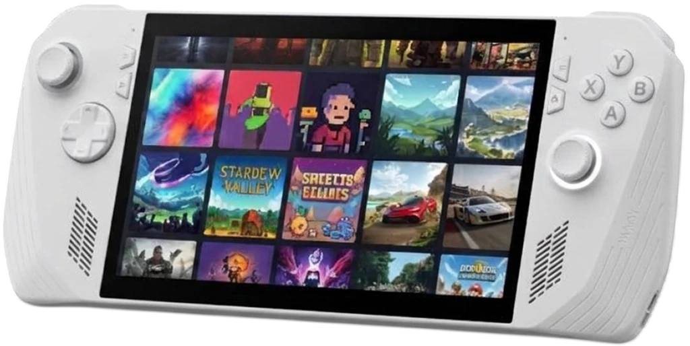
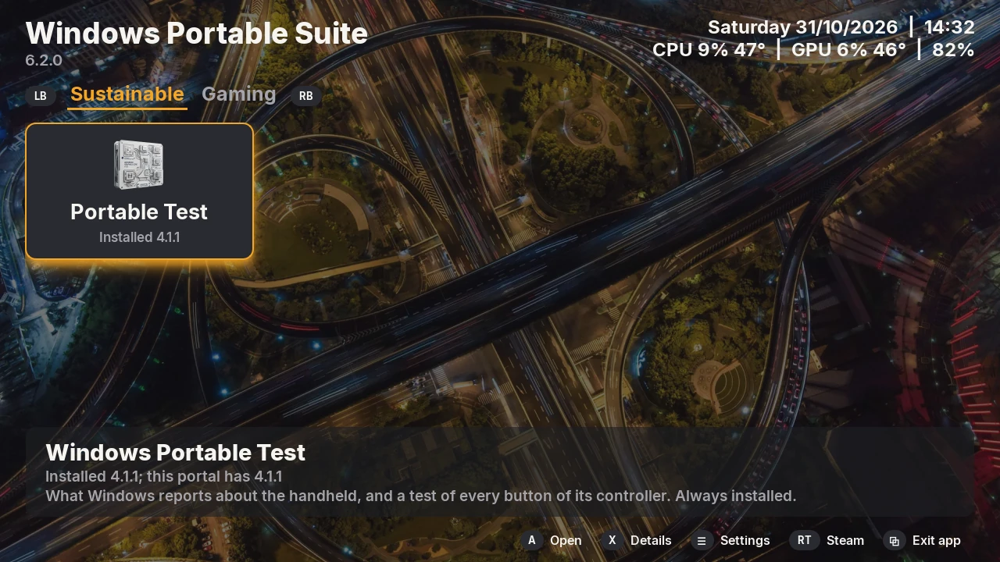

<!-- SPDX-License-Identifier: GPL-3.0-or-later -->

<section class="home-hero" markdown>

{ .home-hero__device }

# Awesome tools to get more out of your portable device. { .home-hero__lead }

More control. More performance. More play.

<strong>Beta</strong> The suite is in active development: features and layout may still change between releases.

</section>

<section class="home-section home-section--dark" markdown>

## In the suite

Apps for a Windows portable device, first the ASUS ROG Xbox Ally X, made for the device in your hands: full screen,
a small screen, a controller and touch. The amber focus shows where the next press of A goes.

#### :material-stethoscope: Sustainable

[Windows Portable Test](apps/test.md) shows what Windows reports about the device, what is built in and what is
plugged in, measures the network with a timed download, and tests every button, stick and trigger of its controller,
the back buttons and the stick lights too. The temperatures, the power draw and the screen's refresh rate stay in its header.

#### :material-gamepad-variant: Gaming

[PCSX2 Manager](apps/pcsx2.md) installs PCSX2, the PlayStation 2 emulator, in portable mode, sets it up for the
device's controller, plays your PS2 games full screen and puts them in Steam.

[PPSSPP Manager](apps/ppsspp.md) installs PPSSPP, the PSP emulator, in portable mode, plays your PSP games full
screen and puts them in Steam.

[RPCS3 Manager](apps/rpcs3.md) installs RPCS3, the PS3 emulator, takes the PS3's firmware and your packages, plays
your PS3 games full screen and puts them in Steam.

[shadPS4 Manager](apps/shadps4.md) installs shadPS4, the PS4 emulator, takes the system modules of your PS4,
unpacks your packages, plays your PS4 games full screen and puts them in Steam.

[Vita3K Manager](apps/vita3k.md) installs Vita3K, the PS Vita emulator, has it install the PS Vita's firmware and your
games, plays your PS Vita games full screen and puts them in Steam.

[Xenia Manager](apps/xenia.md) installs Xenia, the Xbox 360 emulator, finds your Xbox 360 games, plays them full
screen and puts them in Steam.

[Install](install.md){ .md-button }

</section>

<section class="home-section home-section--light" markdown>

## One portal for every app

The portal installs, opens, updates and removes the apps, each from a tested release that it checks before it
unpacks it. The apps are tiles on a tab per category: **LB** and **RB** change the tab, **A** installs or opens the
focused app, **Y** updates it, **X** shows its details. Every tile and button also works by touch.

[About the portal](portal.md){ .md-button }

{ .home-split__picture }

</section>

<section class="home-section home-section--accent" markdown>

## Get started

Download the newest portal on your portable device (under Windows Portable Suite in the Nexus index), check it with
`Get-FileHash` and run its installer. It installs Windows Portable Test with it; every other app installs from the
portal.

[:material-download: Download](https://github.com/RobertoTorino/nexus/releases/latest){ .md-button .md-button--primary }
[Install steps](install.md){ .md-button }

</section>

<section class="home-section home-faq" markdown>

## FAQ

### Do the apps change my device?

No setting of Windows or of the device. Windows Portable Test only reads and shows what Windows reports. PCSX2
Manager and PPSSPP Manager install their emulator in its own folder and write its settings there, and nowhere else.

### Do I need administrator rights?

No. Everything installs for your own user, and the installers refuse an administrator's window. Nothing goes into
the Windows registry.

### Where do the apps keep their files?

The programs, their logs and what they save in `%LOCALAPPDATA%\windows-portable-suite\`, the settings in
`%APPDATA%\windows-portable-suite\`, one `.ini` per app. Each app's chapter lists its files.

### Do I have to install the apps one by one?

No. Install the portal; it installs, updates and removes the apps. See [Install](install.md).

### Does it work on other devices?

The suite is made and tested on the ROG Xbox Ally X with Windows 11, for any Windows portable device: the apps read what
Windows reports, and say so where something does not apply, such as the back buttons on another maker's device.

### How do I check a download?

Every release comes with a `SHA256SUMS` file: in PowerShell,
`(Get-FileHash <file>.zip).Hash -eq (-split (Get-Content SHA256SUMS))[0]` prints `True` when the download is intact.
See [Install](install.md).

### Why does Windows ask before it runs a program?

The programs are not signed, so Windows may ask once whether to run a file a browser downloaded. The portal checks
what it downloads itself.

### Is it open source?

Yes. The code of every app is on [GitHub](https://github.com/RobertoTorino/nexus), under the license below.

### What does the suite know about me?

Nothing it sends anywhere: no accounts, statistics or crash reports. The portal and the apps go to GitHub for their
releases and updates, and Windows Portable Test's Network card downloads a release from GitHub when you ask it to;
the network's name and the access point's address are never read out.

### Where do I get help?

Open an issue on [GitHub](https://github.com/RobertoTorino/nexus/issues).

## License

GPL-3.0-or-later. Each app has its own `LICENSE`. The icons and pictures were made with generative AI tools and
edited by hand, the sounds with generative AI tools; all are under the license of the app or tool they come with,
like its code.

</section>
