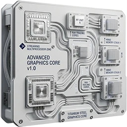

<!-- SPDX-License-Identifier: GPL-3.0-or-later -->

{ .app-logo }

# Portal

The portal installs, updates, opens and removes the suite's apps. Each app comes from its own GitHub release, checked
against the checksum the portal carries for it. Windows Portable Test is always installed with the portal and is the
first tile.

Start it from the Start menu (**Windows Portable Suite**) or the Desktop shortcut. It opens full screen with a short
intro; any button, key or tap skips it.

## The apps page

The apps are tiles under tabs: one tab per category that has apps (Sustainable, Graphics, Gaming, Utilities), two
rows of four tiles each. A tab with more than eight apps has more pages: **Page 1 of 2** under the tiles says which
one shows. Move past the last tile on the right to the next page, or past the first on the left back; a tap on
**Page 1 of 2** turns to the next page, and from the last back to the first. At the right of the tabs, **Installed
12/20** says how many of the suite's apps are on this device, of all the portal lists. A tile shows the app's icon, its name
and its state:

| State | Meaning |
|---|---|
| Not installed | The app is not on this device. |
| Installed x.y.z | The version this portal pins is installed. |
| Update x.y.z | An older release is installed; this portal brings x.y.z. The tile has a red dot at its top right. |
| Installed, version unknown | The app is there, but not installed by this portal. |
| Downloading… 40 MB | The release is coming in. |
| Installing… | Its installer runs in a PowerShell window. |

The strip under the tiles shows the focused app: its name, its versions and what it does.

| Button | What it does |
|---|---|
| D-pad, left stick | Move the amber focus between the tiles |
| LB, RB | The tab to the left or right |
| A | Install the app, or open it once it is installed |
| Y | Update the portal while a newer one is out (**Y Update suite**); otherwise update or reinstall the app, when the row at the bottom offers it |
| X | The app's details |
| ☰ (Menu) | The Settings page, with the settings; on it, what the settings do |
| LT | The portal to the next screen, with a second screen attached |
| RT | Steam's library, in Big Picture mode, when Steam is installed |
| R3 (the right stick pressed) | Windows' touch keyboard, shown or hidden; the row at the bottom shows **R3** with a keyboard symbol (⌨) |
| B | Back: from a page to the tiles; on a tile nothing |
| ⧉ (View) | Exit the portal, after its question |

Every action is a button, in the row at the bottom with what it does for the focused app (**A Install** or **A
Open**, **X Details**, **Y Update**, **☰ Settings**, **RT Steam**, **⧉ Exit**). Every tile works by touch, and so does the row: a
tap on an entry does what the button does. On a keyboard, the arrow keys move, Enter presses and
Escape goes back.

On the Settings page the setting with the focus has the amber edge; the d-pad stays on the page, and **B** goes back to
the tiles.

## Steam

**RT Steam**, in the row at the bottom of every page, opens Steam's library in Big Picture mode, where the games the
game managers put in Steam are played. A Steam that does not run is started first and opens its library once it has
signed in. Pull RT past halfway, or tap the entry. Without Steam on the device the entry is not there; the game
managers then start a game in its emulator themselves.

## Installing and updating an app

**A** on an app that is not installed downloads its release, checks it and runs its installer in a PowerShell
window. The tile counts the megabytes while it downloads. When the installer is done, the window closes by itself;
when it fails, the window stays open so you can read why, and the strip says so too.

An app the portal installs gets a Start-menu entry in the **Windows Portable Suite** folder and no Desktop shortcut:
you start it from the portal.

**Y** updates an app whose tile says **Update x.y.z**: the portal installs the release it pins over the older one.

The portal looks for a newer portal when it starts, every hour while it runs, and when you come back to it from a
game or an app once its last look is a quarter of an hour old. A look that fails (offline for a moment) keeps the
update it found before.

While a newer portal is out, an amber banner on the line of the tabs says **UPDATE AVAILABLE, PRESS Y TO UPDATE**, on
the tiles and on the Settings page. **Y**, or a tap on the banner, updates the portal first, since the new portal brings
the apps' new releases; the row at the bottom says **Y Update suite**. While the portal downloads, the banner counts the
megabytes. Once the portal is up to date the banner is gone, and **Y** updates an app again. When the portal finds the
update while its intro plays, the intro shows **PORTAL UPDATE AVAILABLE** under the suite's name.

## Exiting the portal

**⧉** (View) asks first: "Do you really want to exit the portal?" The row at the bottom then shows the answers,
**⧉ Yes, exit the portal** and **B No, stay**; a second **⧉** closes the portal, and **B**, or five seconds without an
answer, keeps it open. While a download or an installer runs, the question says what exiting does to it: the
download stops, or the installer finishes in its window but the portal does not record it.

## The details page

**X** shows the app's details: the version installed and the one this portal pins, its category and where its
program is. **A Open** opens it and **Y Remove** removes it. Remove asks for a second press within five seconds
instead of a dialog; the row at the bottom says **Press again to remove** meanwhile. **B** goes back to the tiles.

## The Settings page

**☰** shows the Settings page: this portal's version under its name, the newest portal release, and in one line
what that release changes (**updates 8 apps, adds BIOS Reader**). **☰** on the page lists the changes app by app,
from the old version to the new one, above what the settings do. With a newer release, the row at the bottom offers **Y Update to x.y.z**;
otherwise **Y Check again**. A portal newer than every published release (a draft on its device test) says so: the
newest release is **older than this portal, which is not published yet**.
A release of this portal's own version that was built again shows as **a new build of this version** and is offered
the same way: the portal compares the checksum (sha256) of the release's zip with the one it was installed from.
A portal installed without that checksum (from before it was kept, or unpacked without its zip beside it) is offered
the newest build once.
The status line at the top right shows the place's weather when a location is set (**Amsterdam ☁ 9°**: its
symbol and the temperature, looked up again every 15 minutes), the date and the time as the Clock settings say
(**01:14 CET**, **1:14:32 AM UTC**), and **Suite x.y.z available** while there is one.
The line under it shows the CPU and the GPU live, each with its load and its temperature (**CPU 12% 48°**, **GPU 7%
47°**, read every two seconds from AMD's driver and Windows; on a device without AMD's driver the GPU shows only its
temperature), and the battery last, at the right: its percentage, or **Plugged in** while the device is on its
charger. The apps' status lines show the battery the same way. On the ROG XBOX Ally X, the performance mode's letter
stands just before the battery: **S** Silent, **P** Performance, **T** Turbo or **W** Windows, read from Windows'
power plan and power mode, which Armoury Crate's modes set (`CPU 12% 48°  |  GPU 7% 47°  |  T  |  82%`); the **T**
of Turbo is a bright red, in heavier letters. No letter
shows when the plan and the power mode match none of them. Armoury Crate's Command Center keeps its own record of
the mode, so it can show another one.

**Y Update to x.y.z** downloads the new portal; the page counts the megabytes. The portal then closes,
installs the new release in a PowerShell window and starts again. The new release brings the apps it pins: their
tiles then say **Update** where a newer release is pinned.

The settings are on the Settings page too, under the release, in three columns: **Look and device** (how the portal
looks and sounds, the performance mode and XBOX mode), **Clock and weather** (at the top) and **Screens**. They are
kept for the next start.
The d-pad moves up and down a column and left and right between them, **A** on a setting changes it; **B** goes back
to the tiles. What each setting does
is behind the information icon at the top right of the page: **☰** on the Settings page, or a tap on the icon,
shows it, with the pictures in your wallpaper folder that cannot be used and why, and what each button at the
bottom does.

| Setting | |
|---|---|
| Wallpaper | A picture behind the tiles, which show it through them, in every app of the suite, each from its next start. **A** picks the next: **Off** (the plain dark background), **Built-in** (the suite's own picture), then each of your own pictures, by file name (see below). |
| Transparency | How much of the dark background lies over the picture, so the text stays easy to read. **A** adds 10 %, up to 90 %, then starts at 0 %. It starts at 59 %. |
| Sound | The intro's sound when the portal starts, and a short sound on each controller button. Off: both are silent until Windows starts again; after a restart the sound is on. |
| Clock | The time at the top in **24 hours** (17:04) or **12 hours** (5:04 PM). **A** switches. |
| Seconds | **On** shows the seconds too (17:04:09). **A** switches. |
| Time zone | **CET**, Amsterdam time (CEST in summer, as Europe switches on the last Sundays of March and October), or **UTC**; its name follows the time. **A** switches. |
| Location | The place whose weather shows at the top, or **Off**. **A** opens its page: type part of the name (**R3** opens Windows' touch keyboard), **A** searches, and up to five places found are listed with where they are (**Amsterdam, North Holland, Netherlands**), each once; the d-pad picks one and **A** takes it. **Y** goes from the name to the list and back, where **Off** takes the place away. Weather data by [Open-Meteo.com](https://open-meteo.com/). |
| Performance mode | Only on the ROG XBOX Ally X: the active mode (**Other** when the power plan and the power mode match none of them). **A** opens the Performance Mode page, below. |
| XBOX mode ↔ Desktop | **A** switches between XBOX mode and the desktop, either way, as **Win + F11** does. |
| PC screen only | **A** has Windows show its picture on the handheld's screen only, with the sound on its speakers, as **Win + P** names it (see below). |
| Duplicate | **A** has Windows show the same picture on both screens, XBOX mode too; the sound goes to the second screen. |
| Extend | **A** has Windows use both screens, the second one beside the handheld's. XBOX mode stays on the main screen, the handheld's. |
| Second screen only | **A** has Windows show its picture on the second screen only (a TV or a monitor), so XBOX mode, the portal, the games and the sound are all there; the handheld's screen goes dark. |
| Screen | Only with a second screen attached, such as a TV or a monitor: the screen the portal is on, **PC screen** (the handheld's own) or **Other screen**. **A**, or **LT** on any page, moves it to the next screen (see below). |

**Your own wallpapers** go in the folder `%LOCALAPPDATA%\windows-portable-suite\wallpapers`, which the installer
makes: paste that address in File Explorer's address bar and drop the pictures there. Only pictures in that folder
are offered, and only those that fill the screen without blurring: PNG, JPEG or WebP, wider than high, at least
1280 x 720 pixels (1920 x 1080 or larger looks sharp on a TV too). The picture is cropped to the screen, never
stretched. A picture that does not follow these rules is named in the page's information with the reason (**Not
used: small.png (800 x 450, smaller than 1280 x 720)**). Take a picture out of the folder and the apps show the built-in
one again. Your pictures stay when the suite is uninstalled.

### XBOX mode on a TV

XBOX mode runs on Windows' main screen only, the handheld's. With a TV attached and both screens on (**Extend**), the
TV stays empty (white) in XBOX mode while the sound goes to it. Before you switch to XBOX mode, choose where to play
on the Settings page, under **Screens**, with the names **Win + P** gives them:

- **Second screen only**: Windows shows its picture on the TV only, and XBOX mode, the games and the sound are there.
- **Duplicate**: the same picture on the handheld and the TV.
- **Extend**: both screens, the TV beside the handheld's; XBOX mode stays on the handheld.
- **PC screen only**: the handheld's screen only again.

After each, the portal starts again by itself, sized for the screen. Each changes Windows' display setting for
everything on the handheld; Windows' own way, **Win + P**, offers the same four. When you exit the portal (**⧉**), it
sets **PC screen only** again if another one was set on its Settings page; and a restart of the handheld comes back
on its own screen as well: until then a shortcut in your Startup folder,
`%APPDATA%\Microsoft\Windows\Start Menu\Programs\Startup\Windows Portable Suite - PC screen only.lnk`, sets **PC
screen only** when you sign in. **PC screen only** on the Settings page, or exiting the portal, takes it away, and so
does the portal's uninstaller.

**XBOX mode ↔ Desktop** on the Settings page switches to XBOX mode, and from XBOX mode back to the desktop: it presses
**Win + F11** for you, Windows' own switch. Coming back to XBOX mode after the desktop, Windows may ask whether to
restart the handheld for better performance; that question is Windows', answered with the controller. Windows' own
way out stays too: the Windows key, **Exit XBOX mode**.

### Sound on a TV

With a TV attached over HDMI, Windows plays the sound on the TV, and it decides whether the TV is there by the HDMI
connection, not by what the TV shows. Most TVs keep a port connected when you switch them to another input: Windows
still sees the TV and keeps playing the sound to it, which the TV no longer plays. The sound moves to the handheld's
speakers only when the HDMI connection goes down, and that happens when the handheld's screen turns off; when you wake
the screen, the connection comes back and the sound goes to the TV again.

This is how it went on a ROG XBOX Ally X with a TV, YouTube playing, Windows' sound outputs read every two seconds:

| What you do | What Windows does | What you hear |
|---|---|---|
| YouTube plays on the TV | The TV's HDMI output is on and is the default output. | The sound on the TV. |
| Switch the TV to another input | Nothing changes: the TV's output stays the default, and Windows still counts two screens. | Nothing. |
| Leave the handheld until its screen turns off | The TV's output goes (unplugged), and the handheld's speakers become the default. | The sound on the handheld. |
| Wake the handheld's screen | The TV's output is back and is the default again. | Nothing again. |

The same happens after a restart: with the TV on and the cable in, even on another input, Windows starts with the
TV as its sound output.

While the portal runs, it says every change of where Windows plays the sound in a Windows notification, seen
whatever is in front: **Sound plays on: PC speakers** (the handheld's own, or other speakers), **Other screen** (a
TV's or a monitor's HDMI or DisplayPort) or **headphones**. It goes by the kind of output Windows reports, never a
device's name. The moment the TV switches to another input cannot be said, as Windows does not see it. Windows holds
notifications back while **Do not disturb** is on, which it can switch on by itself during a game or a full-screen
app.

The portal does not choose where the sound plays; to hear it on the handheld:

- Choose the handheld's speakers in Windows' **Settings > System > Sound**, and the TV there when you watch on it.
- Look in the TV's settings for an option that turns an HDMI port off when it is not selected (often under energy
  saving or HDMI-CEC). Windows then sees the TV go when you switch inputs and plays the sound on the handheld.
- Take the cable out when the TV is in use for something else.

## The Performance Mode page

On the ROG XBOX Ally X, the Settings page's **Performance mode** row opens a page with the performance modes Armoury
Crate's Command Center offers: **Silent**, **Performance**, **Turbo** and **Windows**. Each row shows the mode's
watt limits on the power source the device is on now (the line under the title: **On the charger** or **On
battery**): sustained, slow and fast, as measured on the Ally X. Armoury Crate keeps one set for the charger and one
for the battery; the rows change when the charger is plugged in or out. The active mode says **(active)**, and has the
focus when the page opens.

| Mode | On the charger | On battery |
|---|---|---|
| Silent | 13 / 16 / 20 W | 13 / 16 / 20 W |
| Performance | 17 / 21 / 26 W | 17 / 21 / 26 W |
| Turbo | 35 / 44 / 55 W | 25 / 30 / 36 W |
| Windows | 17 / 21 / 26 W | 17 / 21 / 26 W |

**Silent** uses the least power and stays the coolest and quietest; **Performance** is the middle; **Turbo** uses
the most and drains the battery fastest, and in a game that already reaches its frame cap it buys nothing.
**Windows** goes back to Windows' own Balanced power plan, with Windows' power mode left as you chose it.

**A** sets the mode with the focus: its power plan and Windows' power mode, at once, as Command Center would, and
its watt limits through the helper (below). The letter in the header follows. The line at the bottom of the page says
what happened: **Turbo set, with its watts: 25 / 30 / 36 W.**, or why the watts were not written. **B** goes back to
the Settings page, **☰** shows what the page does.

**Watt limits**, under the modes: only an administrator may write the watts, so a small helper does, installed once.
**A** on **Install** shows Windows' administrator prompt; after a yes the row says **Installed**. From then on a
mode set here gets its watts too, and the helper sets the whole mode again a few seconds after the charger is plugged
in or out, after Armoury Crate has set its own mode for that power source. **A** on **Installed** removes it, with
the same prompt; uninstalling the suite removes it too. Without the helper, a mode set here leaves the watts as
Armoury Crate set them.

The helper is one of the suite's three parts that run as administrator (the others are [USB HD Cam](apps/hdcam.md)'s
Allow access, which installs one driver, and [BIOS Reader](apps/bios.md)'s Read the settings, which only reads). It is a script in
`C:\Program Files\windows-portable-suite\`, which only an administrator may change, run by the scheduled task
**Windows Portable Suite\Operating Mode** (Task Scheduler) as the system account. The portal only names the mode, in
`C:\ProgramData\windows-portable-suite\operating-mode` (one letter); the watts are the helper's own table. What it
did last is in `operating-mode-result` and `operating-mode.log` beside it.

The helper also sets the mode again after a restart: 20 seconds and 2 minutes after you sign in, once Armoury Crate's
services have set their own mode at Windows' start.

Command Center keeps its own record of the mode: after a change here it may still show the mode picked there.

The window fits the screen it is on: it is laid out for the Ally's 1280 x 720 (at Windows' 150 % scaling) and drawn
larger on a larger screen, such as a TV, and smaller on a smaller one.

**With a second screen** attached, such as a TV or a monitor, the portal and the suite's apps open on the screen they
were last moved to, **PC screen** (the handheld's own, as Windows reports it built in) or **Other screen** (any
other one, whatever its make), while there is one, otherwise on Windows' main display. To move one to the other screen, use
the Settings page's **Screen** row or **LT** (the row at the bottom shows **LT Screen** then), or press **Win +
Shift + Left** (or **Right**) with its window in front, which works for every app of the suite; the row at the bottom
shows those keys at its left, after a symbol of two screens with an arrow between them. The window cannot be dragged: it is full screen, without a title bar. On a screen
of another size the app starts again there, sized for that screen, in a second or two; a download or an install
finishes first, and the portal says it will move once that is done.

The window always fills the screen it is on, exactly. When Windows moves it or changes its size (switching the
display setup, changing a screen's resolution or scaling, attaching or removing a screen), the app puts itself back
on that screen's full area a second or two later; when the screen is now another size, it starts again there, sized
for it.

## Files

| Where | What |
|---|---|
| `%LOCALAPPDATA%\windows-portable-suite\portal\app\` | The portal's program, and `build.sha256`: the checksum of the release zip it was installed from |
| `%LOCALAPPDATA%\windows-portable-suite\portal\releases\<tag>\` | The release each app was installed from, kept for its uninstaller |
| `%LOCALAPPDATA%\windows-portable-suite\portal\installed.json` | Which release of each app the portal installed |
| `%LOCALAPPDATA%\windows-portable-suite\portal\portal.log` | The portal's log |
| `%APPDATA%\windows-portable-suite\portal.ini` | Its settings: the last tab |
| `C:\Program Files\windows-portable-suite\` | The Performance Mode helper, on the ROG XBOX Ally X once installed from its page |
| `C:\ProgramData\windows-portable-suite\` | The mode the helper applies, its last result and its log |
